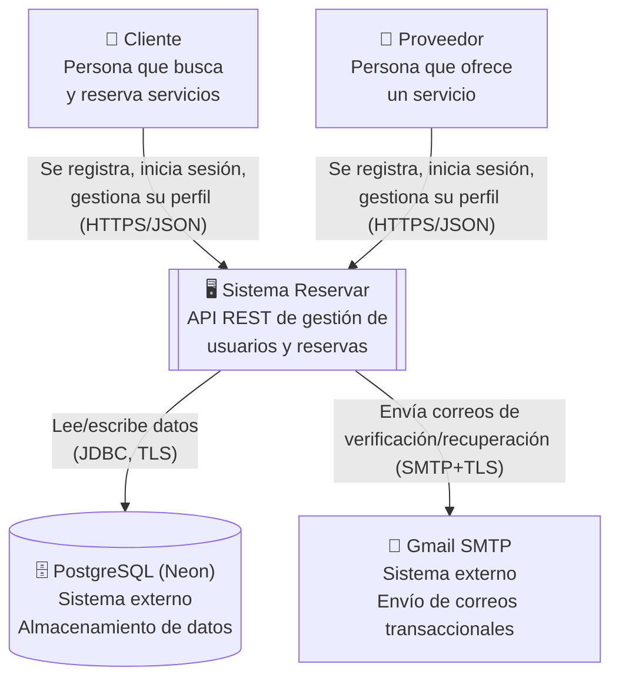
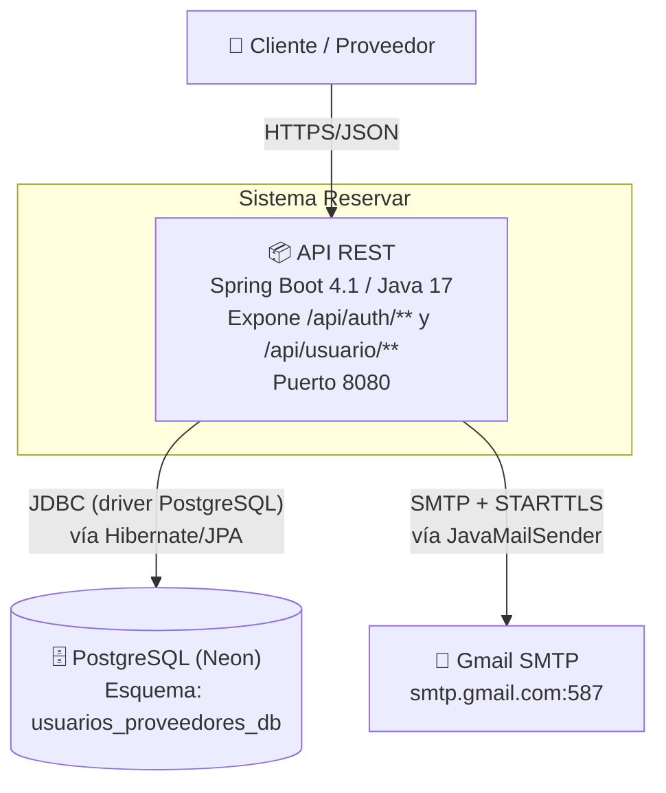
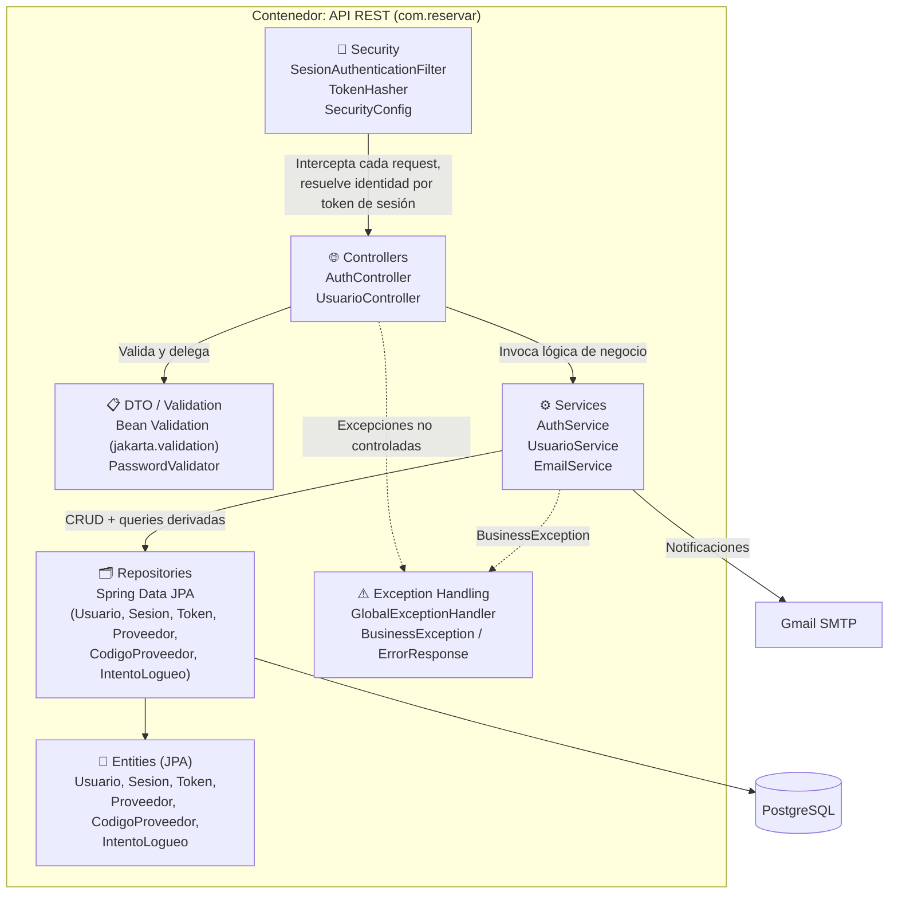

# Arquitectura del sistema — Reservar

**Proyecto:** Reservar. Plataforma de reservas (Fábrica Escuela EAV09).\
**Alcance de este documento:** Épica 1: Gestión de Usuarios y Acceso a la Plataforma (Sprint 1).\
**Stack:** Spring Boot 4.1 (Java 17), PostgreSQL (Neon), Spring Security, Spring Data JPA / Hibernate

> Este documento no cubre frontend (no hay requerimiento de frontend en el proyecto) ni estrategia de despliegue (queda pendiente hasta que todas las épicas estén completas).
> Se enfoca en la arquitectura del backend construido hasta el momento.

---

## 1. Introducción

Reservar es una API REST para la gestión de reservas entre **clientes** y **proveedores de servicios**.
Este documento describe la arquitectura del backend implementado en el Sprint 1, correspondiente a la
Épica 1 (registro, autenticación, verificación de correo, gestión de perfil y recuperación de contraseña).

Se documenta siguiendo el modelo **C4** (Contexto, Contenedores, Componentes) y se justifican las decisiones de estilo arquitectónico,
persistencia y seguridad.

---

## 2. Diagrama C4 — Nivel 1: Contexto

Muestra el sistema como una caja negra y sus interacciones con actores y sistemas externos.

**Actores y sistemas externos:**

| Elemento | Tipo | Descripción |
|---|---|---|
| Cliente | Persona | Usuario que consume servicios ofrecidos en la plataforma |
| Proveedor | Persona | Usuario que ofrece un servicio, requiere código de proveedor válido para registrarse |
| Sistema Reservar | Sistema de software (este proyecto) | Backend API REST |
| PostgreSQL (Neon) | Sistema externo | Base de datos relacional gestionada, alojada en la nube |
| Gmail SMTP | Sistema externo | Proveedor de correo saliente para verificación, recuperación y confirmación de cambio de correo |

---

## 3. Diagrama C4 — Nivel 2: Contenedores

Descompone el sistema en los "contenedores" desplegables/ejecutables que lo componen.

**Justificación:** un único contenedor desplegable (monolito modular) es suficiente y apropiado para el
alcance académico y el tamaño del equipo.

---

## 4. Diagrama C4 — Nivel 3: Componentes (dentro del contenedor API REST)

**Responsabilidad de cada componente:**

| Componente | Responsabilidad |
|---|---|
| `security` | Autenticación por token de sesión opaco (no JWT); construye el `Authentication` de Spring Security en cada request |
| `controller` | Adaptador HTTP: recibe DTOs validados, delega en el service, traduce el resultado a `ResponseEntity` |
| `dto` + Bean Validation | Contrato de entrada/salida de la API; validaciones declarativas (`@NotBlank`, `@Email`, `@Pattern`, etc.) |
| `service` | Reglas de negocio — es la única capa que orquesta transacciones (`@Transactional`) |
| `repository` | Acceso a datos vía Spring Data JPA; consultas derivadas y `@Query` explícitas cuando se requiere `JOIN FETCH` |
| `entity` | Modelo de persistencia, mapeado 1:1 contra el esquema físico de PostgreSQL |
| `exception` | Traducción centralizada de errores de negocio y de validación a respuestas HTTP consistentes |

---

La estructura de paquetes replica una **arquitectura en capas** clásica de
Spring Boot: `controller → service → repository → entity`, con paquetes transversales (`security`,
`exception`, `config`, `validation`) que no pertenecen a ninguna capa de negocio específica.

---

## 5. Estilo arquitectónico

**Estilo elegido:** monolito modular en capas, organizado por tipo técnico de
componente (`controller`, `service`, `repository`, `entity`) en un único módulo Maven.

**Justificación**:
- El dominio actual (gestión de usuarios) es cohesivo y no presenta necesidad de escalar
  independientemente sus partes.
- El equipo es pequeño (proyecto académico), por lo que la sobrecarga operativa de microservicios
  (orquestación, descubrimiento de servicios, comunicación de red, consistencia eventual) no se
  justifica frente al beneficio.
- Spring Boot favorece este estilo de forma nativa (auto-configuración, un único `ApplicationContext`).
- La organización por capas técnicas (en lugar de por *feature*) fue suficiente para el tamaño actual
  del código (Épica 1); si el proyecto crece a más épicas con dominios claramente separados (ej.
  `reservas`, `pagos`, `catálogo de servicios`), se evaluará migrar a paquetes por *feature*
  (organización vertical) manteniendo el mismo estilo de monolito modular.

---

## 6. Persistencia

- **Tecnología:** Spring Data JPA sobre Hibernate 7, contra PostgreSQL 18 (Neon, servicio gestionado en la nube).
- **Estrategia de esquema:** `spring.jpa.hibernate.ddl-auto=validate` — el esquema SQL se versiona y
  gestiona de forma explícita (DDL escrito a mano), y Hibernate únicamente **valida** que las entidades
  coincidan con él al arrancar. Esto evita que un mapeo incorrecto en el código altere silenciosamente
  el esquema de una base de datos compartida por el equipo.
- **Tipos de datos especializados usados de PostgreSQL:**
  - `UUID` como clave primaria en `USUARIO`, `SESION`, `TOKEN` — evita IDs secuenciales predecibles
    en identificadores expuestos externamente (buena práctica de seguridad por diseño).
  - `CITEXT` en `correo` y `correo_pendiente` — comparaciones case-insensitive nativas en BD, en vez de
    normalizar manualmente a minúsculas en cada consulta.
  - `INET` en `ip_origen` (`INTENTOS_LOGUEO`, `SESION`) — validación de formato de IP a nivel de motor
    de base de datos, y soporte nativo para operadores de red si se necesitan en el futuro (ej.
    detección de rangos sospechosos).
  - Mapeados en JPA mediante `columnDefinition` + `@ColumnTransformer(write = "?::inet")` para conciliar
    el tipo `String` de Java con el tipo nativo de PostgreSQL sin perder la validación de esquema.

---

## 7. Seguridad

### 7.1 Autenticación

- **Hash de contraseñas:** BCrypt (`BCryptPasswordEncoder`), costo por defecto — nunca se almacena
  contraseña en texto plano (`USUARIO.hash_contrasena`).
- **Sesiones por token opaco (no JWT):** al iniciar sesión se genera un token aleatorio de 256 bits
  (`SecureRandom`), se persiste su **hash SHA-256** en la tabla `SESION`, y el token en texto plano se
  entrega una única vez al cliente. Cada request posterior envía `Authorization: Bearer <token>`; un
  filtro (`SesionAuthenticationFilter`) lo hashea, busca la sesión activa y no expirada, y construye el
  `Authentication` de Spring Security con el `Usuario` correspondiente.
- **Justificación de tokens opacos server-side vs JWT:**
- **Expiración diferenciada por tipo de token** (tabla `TOKEN.tipo`):

  | Tipo | Expira en | Uso |
  |---|---|---|
  | `VERIFICACION` | 24 horas | Activar cuenta tras registro |
  | `RECUPERACION` | 1 hora | Restablecer contraseña olvidada |
  | `ACTUALIZACION` | 1 hora | Confirmar cambio de correo electrónico |
  | Sesión (`SESION`) | 24 horas | Autenticación en cada request |

- **Mitigación de fuerza bruta:** bloqueo temporal de 15 minutos tras 5 intentos fallidos consecutivos
  (`USUARIO.intentos_fallidos`, `USUARIO.bloqueado_hasta`), con auditoría de cada intento (exitoso o no)
  en `INTENTOS_LOGUEO`, incluyendo IP de origen y user-agent.
- **Invalidación de sesiones:** al confirmar un cambio de contraseña, todas las sesiones activas del
  usuario se revocan (`SESION.fecha_revocacion`), forzando un nuevo inicio de sesión en cualquier
  dispositivo.

### 7.2 Autorización (RBAC)

- **Roles del dominio:** `CLIENTE`, `PROVEEDOR` (enum `Rol`, columna `USUARIO.rol`).
- El filtro de autenticación traduce el rol del usuario en una `GrantedAuthority` de Spring Security
  (`ROLE_CLIENTE` / `ROLE_PROVEEDOR`), dejando la infraestructura lista para autorización declarativa
  por rol (`@PreAuthorize("hasRole('PROVEEDOR')")`) en los controllers.
- **Estado actual (Sprint 1 / Épica 1):** todos los endpoints autenticados (`/api/usuario/**`) son
  accesibles por cualquier rol autenticado, ya que la gestión de perfil aplica indistintamente a
  clientes y proveedores — no hay, en esta épica, un recurso que deba restringirse *solo* a un rol.
- **Plan de extensión:** a medida que se implementen las épicas de reservas y catálogo de servicios,
  los endpoints específicos de proveedor (ej. publicar/editar un servicio) se protegerán con
  `@PreAuthorize("hasRole('PROVEEDOR')")`, y los de cliente (ej. crear una reserva) con
  `@PreAuthorize("hasRole('CLIENTE')")`, reutilizando la misma infraestructura de autenticación ya
  construida.

### 7.3 Control de permisos por endpoint (estado actual)

| Endpoint | Método | Acceso | Notas |
|---|---|---|---|
| `/api/auth/registro/cliente` | POST | Público | — |
| `/api/auth/registro/proveedor` | POST | Público | Requiere código de proveedor válido y no usado |
| `/api/auth/verificar/{token}` | GET | Público | Token de un solo uso, expira en 24h |
| `/api/auth/login` | POST | Público | Registra intento en `INTENTOS_LOGUEO`, bloqueo tras 5 fallos |
| `/api/auth/recuperacion/solicitar` | POST | Público | No revela si el correo existe |
| `/api/auth/recuperacion/confirmar` | POST | Público | Token de un solo uso, expira en 1h; revoca sesiones activas |
| `/api/usuario/perfil` | GET | Autenticado (cualquier rol) | Requiere `Authorization: Bearer <token>` |
| `/api/usuario/perfil` | PUT | Autenticado (cualquier rol) | Solo modifica el perfil del propio usuario autenticado |
| `/api/usuario/correo/confirmar/{token}` | GET | Público | Token de un solo uso, expira en 1h |

---

## 8. Manejo de errores

- **Centralizado** mediante `@RestControllerAdvice` (`GlobalExceptionHandler`), en lugar de manejo
  ad-hoc por controller.
- **Contrato de error único** (`ErrorResponse`): `codigo` (string simbólico, ej. `CORREO_EXISTENTE`),
  `mensaje` (texto para el usuario), `fecha`, y `errores` (lista opcional, usada en errores de
  validación de campo por campo).
- **`BusinessException`** — excepción de dominio con código simbólico, lanzada por la capa de servicio
  cuando se viola una regla de negocio (ej. `CUENTA_BLOQUEADA`, `TOKEN_EXPIRADO`, `CORREO_EN_USO`).
  Se traduce siempre a `400 Bad Request` con el código correspondiente.
- **Errores de validación de Bean Validation** (`MethodArgumentNotValidException`,
  `ConstraintViolationException`) se interceptan aparte y se listan campo por campo en `errores`, sin
  exponer detalles internos de Hibernate/Spring.
- **Justificación:** centralizar el manejo de errores evita duplicar bloques `try/catch` en cada
  controller, garantiza que el formato de error sea idéntico en toda la API (crítico para que un cliente
  HTTP —o Postman, en las pruebas manuales— pueda parsear errores de forma predecible), y aísla la capa
  de negocio de los detalles del protocolo HTTP (los services lanzan `BusinessException`, no conocen
  códigos de estado).

---

## 9. Reglas de negocio (más allá de CRUD)

La Épica 1 no se limita a operaciones CRUD sobre `USUARIO`; incluye las siguientes reglas de negocio
con estado y transiciones propias:

1. **Ciclo de vida de la cuenta:** `PENDIENTE → ACTIVO` (solo vía verificación de correo con token
   válido y no expirado) y `ACTIVO → INACTIVO` (reservado para administración, fuera de alcance de este
   sprint).
2. **Bloqueo temporal por fuerza bruta:** 5 intentos fallidos consecutivos bloquean la cuenta 15 minutos,
   con reseteo automático del contador al expirar el bloqueo o al autenticarse con éxito.
3. **Códigos de proveedor de un solo uso:** un `CODIGO_PROVEEDOR` transiciona `DISPONIBLE → USADO` al
   registrarse un proveedor, o `DISPONIBLE → EXPIRADO` si su fecha de expiración ya pasó al momento del
   registro — en ambos casos, el registro se rechaza.
4. **Cambio de correo con doble confirmación:** el nuevo correo se guarda en `correo_pendiente` y solo
   reemplaza a `correo` cuando el usuario confirma mediante un token enviado al correo *nuevo*; hasta
   entonces, el correo activo (y con el que se inicia sesión) sigue siendo el anterior.
5. **Invalidación en cascada de sesiones:** un cambio de contraseña por recuperación revoca todas las
   sesiones activas del usuario, como medida de seguridad ante la posibilidad de que la contraseña
   anterior estuviera comprometida.
6. **Tokens de un solo uso con expiración diferenciada por propósito** (ver tabla en sección 8.1) —
   cada tipo de token tiene su propia ventana de validez según el riesgo asociado (recuperación de
   contraseña es más sensible que verificación inicial de correo).

---

