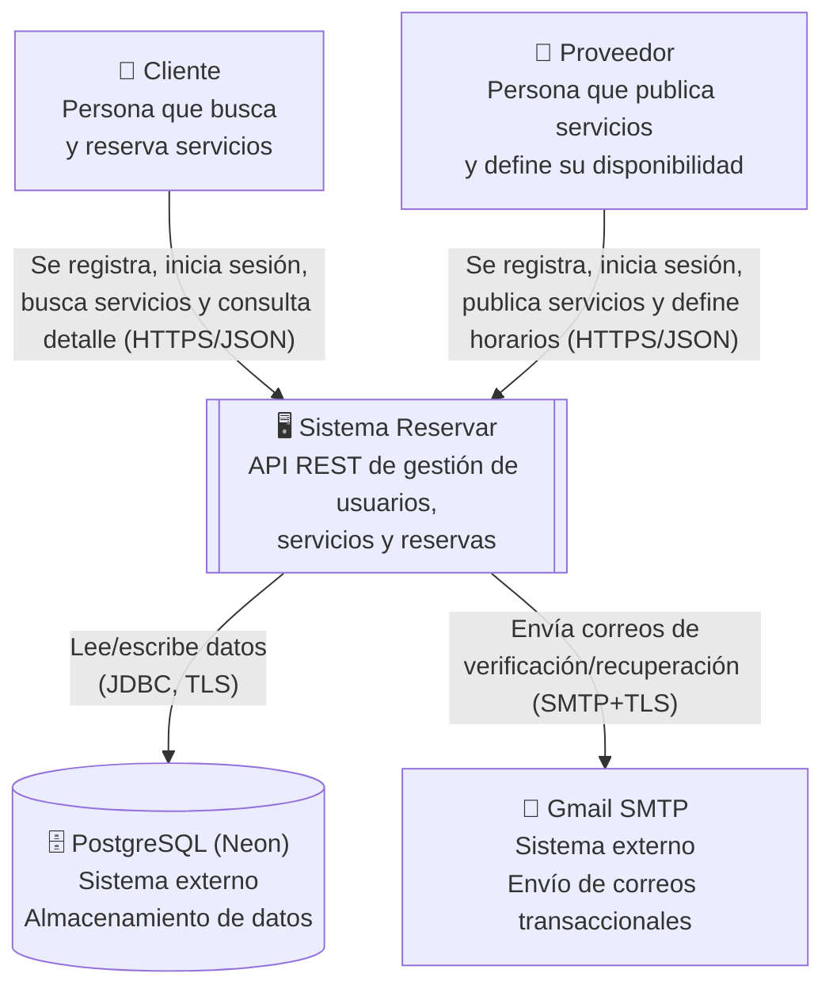
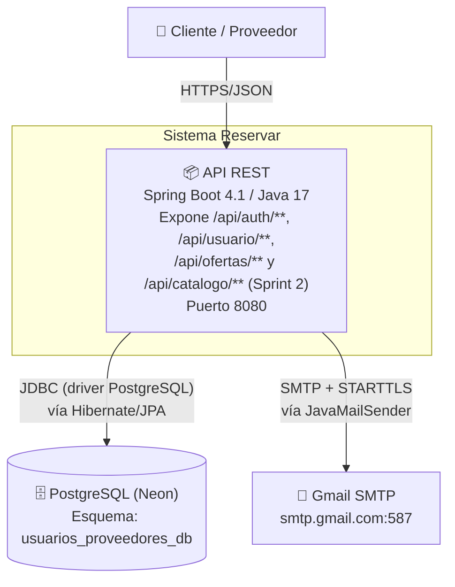
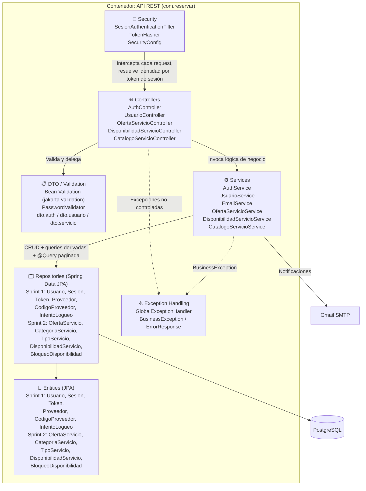
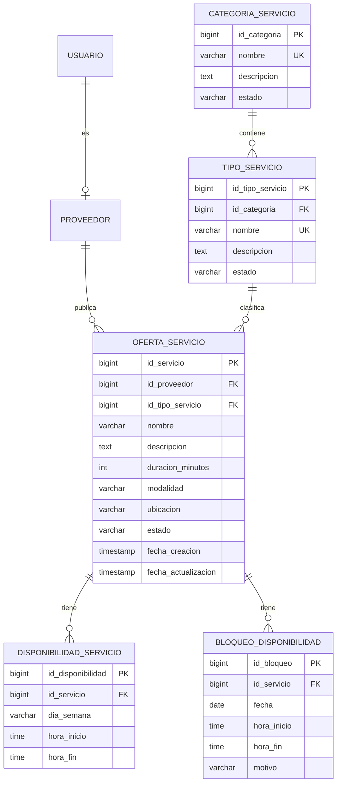
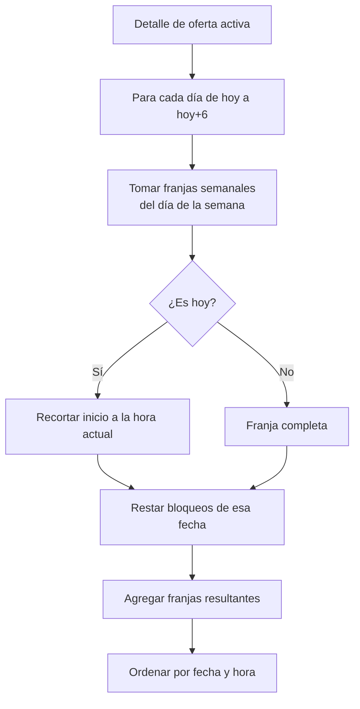

# Arquitectura del sistema — Reservar

**Proyecto:** Reservar. Plataforma de reservas (Fábrica Escuela EAV09).\
**Alcance de este documento:** Épica 2: Gestión de Servicios y Disponibilidad (Sprint 2). Incluye lo ya construido en la Épica 1 (Sprint 1).\
**Stack:** Spring Boot 4.1 (Java 17), PostgreSQL (Neon), Spring Security, Spring Data JPA / Hibernate\
**Última actualización:** 2026-10-09 (commit `8fe5cff` más MER actualizado: sin `PROVEEDOR.tipo_servicio`)

> Este documento no cubre frontend (no hay requerimiento de frontend en el proyecto) ni estrategia de despliegue (queda pendiente hasta que todas las épicas estén completas).
> Se enfoca en la arquitectura del backend construido hasta el Sprint 2. Las secciones que no cambiaron respecto al Sprint 1 se conservan; las nuevas o modificadas se indican con **(Sprint 2)**.
 
---

## Cómo ejecutar el proyecto y las pruebas

Requisitos: JDK 17 o superior. No hace falta instalar Maven (se usa el wrapper `mvnw`).

1. Copiar `.env.example` como `.env` (está en `.gitignore`) o exportar las variables en el sistema / IDE:

   | Variable | Uso |
   |---|---|
   | `DB_USER`, `DB_PWORD` | Usuario y contraseña de PostgreSQL (Neon) |
   | `MAIL_USER`, `MAIL_PWORD` | Cuenta Gmail SMTP (contraseña de aplicación) para los correos de verificación y recuperación |
   | `SONAR_TOKEN` | Solo en GitHub Actions (secret) para el análisis SonarCloud |

2. Pruebas + cobertura + regla JaCoCo: `./mvnw verify` (reporte en `target/site/jacoco/index.html`).
   Sin `DB_USER`, la prueba de integración `ReservarApplicationTests` se omite y el resto del suite (unitario) corre igual.
3. Levantar la API: `./mvnw spring-boot:run` (puerto 8080).

---

## 1. Introducción

Reservar es una API REST para la gestión de reservas entre **clientes** y **proveedores de servicios**.

- **Sprint 1 (Épica 1):** registro, autenticación, verificación de correo, gestión de perfil y recuperación de contraseña.
- **Sprint 2 (Épica 2):** los proveedores publican y administran sus ofertas de servicio y definen su disponibilidad (franjas semanales y bloqueos de fechas puntuales); los clientes buscan, filtran y consultan el detalle de un servicio con sus próximas franjas disponibles. El Sprint 2 deja todo listo para que el Sprint 3 implemente la reserva en sí.
  Se documenta siguiendo el modelo **C4** (Contexto, Contenedores, Componentes) y se justifican las decisiones de estilo arquitectónico, persistencia y seguridad.

---

## 2. Diagrama C4 — Nivel 1: Contexto

Muestra el sistema como una caja negra y sus interacciones con actores y sistemas externos.

**Actores y sistemas externos:**

| Elemento | Tipo | Descripción |
|---|---|---|
| Cliente | Persona | Usuario que explora y consume servicios ofrecidos en la plataforma |
| Proveedor | Persona | Usuario que ofrece servicios; requiere código de proveedor válido para registrarse y cuenta activa para publicar |
| Sistema Reservar | Sistema de software (este proyecto) | Backend API REST |
| PostgreSQL (Neon) | Sistema externo | Base de datos relacional gestionada, alojada en la nube |
| Gmail SMTP | Sistema externo | Proveedor de correo saliente para verificación, recuperación y confirmación de cambio de correo |

> Fuera de alcance del Sprint 2 (según la épica): pagos en línea, notificaciones push/SMS, integración con mapas o geolocalización de terceros (la ubicación se guarda como texto libre) y múltiples sedes por proveedor. Por eso no aparecen nuevos sistemas externos respecto al Sprint 1.
 
---

## 3. Diagrama C4 — Nivel 2: Contenedores

Descompone el sistema en los "contenedores" desplegables/ejecutables que lo componen.

**Justificación:** un único contenedor desplegable (monolito modular) sigue siendo suficiente y apropiado para el alcance académico y el tamaño del equipo. Las ofertas y la disponibilidad se agregan al mismo contenedor y a la misma base de datos, sin nuevos servicios.
 
---

## 4. Diagrama C4 — Nivel 3: Componentes (dentro del contenedor API REST) **(Sprint 2)**

**Responsabilidad de cada componente:**

| Componente | Responsabilidad |
|---|---|
| `security` | Autenticación por token de sesión opaco (no JWT); construye el `Authentication` de Spring Security en cada request |
| `controller` | Adaptador HTTP: recibe DTOs validados, delega en el service, traduce el resultado a `ResponseEntity`. En Sprint 2 los controllers extraen el `Usuario` autenticado del `SecurityContext` y lo pasan al service |
| `dto` + Bean Validation | Contrato de entrada/salida de la API; validaciones declarativas (`@NotBlank`, `@NotNull`, `@Positive`, `@Size`, etc.) |
| `service` | Reglas de negocio — única capa que orquesta transacciones (`@Transactional`). Aquí viven la autorización por propiedad del recurso y el cálculo de próximas franjas |
| `repository` | Acceso a datos vía Spring Data JPA; consultas derivadas y `@Query` explícitas (búsqueda paginada de ofertas activas) |
| `entity` | Modelo de persistencia, mapeado 1:1 contra el esquema físico de PostgreSQL |
| `exception` | Traducción centralizada de errores de negocio y de validación a respuestas HTTP consistentes |

La estructura de paquetes replica una **arquitectura en capas** clásica de Spring Boot: `controller → service → repository → entity`, con paquetes transversales (`security`, `exception`, `config`, `validation`) que no pertenecen a ninguna capa de negocio específica.
 
---

## 5. Estilo arquitectónico

**Estilo elegido:** monolito modular en capas, organizado por tipo técnico de componente (`controller`, `service`, `repository`, `entity`) en un único módulo Maven.

**Justificación:**
- El dominio (usuarios, catálogo y disponibilidad) sigue siendo cohesivo y no presenta necesidad de escalar independientemente sus partes.
- El equipo es pequeño (proyecto académico), por lo que la sobrecarga operativa de microservicios (orquestación, descubrimiento de servicios, comunicación de red, consistencia eventual) no se justifica frente al beneficio.
- Spring Boot favorece este estilo de forma nativa (auto-configuración, un único `ApplicationContext`).
- **(Sprint 2)** Con la segunda épica los paquetes de ofertas y disponibilidad ya conviven con los de usuarios dentro de las mismas carpetas técnicas, apoyándose en una sub-organización por dominio solo en `dto` (`auth`, `usuario`, `servicio`). Con la Épica 3 (reservas) el número de clases por carpeta crece; se evaluará migrar a paquetes por *feature* (`usuarios`, `catalogo`, `reservas`) manteniendo el monolito modular.
---

## 6. Persistencia

- **Tecnología:** Spring Data JPA sobre Hibernate 7, contra PostgreSQL 18 (Neon, servicio gestionado en la nube).
- **Estrategia de esquema:** `spring.jpa.hibernate.ddl-auto=validate` — el esquema SQL se versiona y gestiona de forma explícita (`ESTRUCTURAS.sql`, DDL escrito a mano, dividido por sprint), y Hibernate únicamente **valida** que las entidades coincidan con él al arrancar. Esto evita que un mapeo incorrecto en el código altere silenciosamente el esquema de una base de datos compartida por el equipo.
- **Tipos de datos especializados usados de PostgreSQL (Sprint 1):**
  - `UUID` como clave primaria en `USUARIO`, `SESION`, `TOKEN` — evita IDs secuenciales predecibles en identificadores expuestos externamente.
  - `CITEXT` en `correo` y `correo_pendiente` — comparaciones case-insensitive nativas en BD.
  - `INET` en `ip_origen` (`INTENTOS_LOGUEO`, `SESION`) — validación de formato de IP a nivel de motor. Mapeado en JPA con `columnDefinition` + `@ColumnTransformer(write = "?::inet")`.
### 6.1 Modelo de datos del Sprint 2

**Decisiones de modelado y restricciones en base de datos (Sprint 2):**

| Decisión | Detalle |
|---|---|
| Catálogo en dos niveles | `CATEGORIA_SERVICIO` (lista cerrada: SALUD, BELLEZA, DEPORTE, BIENESTAR, EDUCACION, HOGAR) → `TIPO_SERVICIO` (ej. Odontología, Yoga). La oferta referencia el **tipo**; la categoría se deriva. Ambos se pueblan con datos iniciales en `ESTRUCTURAS.sql` |
| Tipo de servicio solo vía catálogo | `PROVEEDOR` ya **no** tiene `tipo_servicio` (texto libre): el tipo de servicio se expresa únicamente a través de `OFERTA_SERVICIO.id_tipo_servicio` (ver ADR-06).|
| Desactivación lógica | `OFERTA_SERVICIO.estado` (`ACTIVO`/`INACTIVO`): nunca se borra una oferta, así se conserva el historial que Sprint 3 asociará a ella |
| Ubicación condicional | `CHECK chk_oferta_ubicacion`: si `modalidad = 'PRESENCIAL'`, `ubicacion` es obligatoria y no vacía; si es `REMOTO`, puede ser nula |
| Franjas coherentes | `CHECK hora_inicio < hora_fin` en `DISPONIBILIDAD_SERVICIO` y `BLOQUEO_DISPONIBILIDAD` |
| Sin traslapes (franjas) | `EXCLUDE USING gist` sobre (`id_servicio`, `dia_semana`, rango de horas `[)`) — requiere la extensión `btree_gist`. Es la garantía final contra condiciones de carrera; el servicio valida antes para devolver un mensaje específico |
| Índices | `idx_oferta_proveedor`, `idx_oferta_tipo_servicio`, `idx_oferta_estado`, `idx_tipo_servicio_categoria`, `idx_disponibilidad_servicio_dia`, `idx_bloqueo_servicio_fecha`, creados según los patrones de consulta de búsqueda y de cálculo de disponibilidad |
| Bloqueo como excepción puntual | `BLOQUEO_DISPONIBILIDAD` es independiente de la configuración recurrente: bloquear una fecha no elimina ni modifica las franjas semanales. `motivo` admite `RESERVADO` (previsto para el Sprint 3) y `OTRO` |
 
---

## 7. Seguridad

### 7.1 Autenticación

- **Hash de contraseñas:** BCrypt (`BCryptPasswordEncoder`), costo por defecto — nunca se almacena contraseña en texto plano (`USUARIO.hash_contrasena`).
- **Sesiones por token opaco (no JWT):** al iniciar sesión se genera un token aleatorio de 256 bits (`SecureRandom`), se persiste su **hash SHA-256** en la tabla `SESION`, y el token en texto plano se entrega una única vez al cliente. Cada request posterior envía `Authorization: Bearer <token>`; un filtro (`SesionAuthenticationFilter`) lo hashea, busca la sesión activa y no expirada, y construye el `Authentication` de Spring Security con el `Usuario` correspondiente.
- **Justificación de tokens opacos server-side vs JWT:** la sesión se puede revocar de inmediato (cambio de contraseña, cierre forzado) porque el servidor es la fuente de verdad; con JWT autocontenido habría que mantener una lista de revocación o aceptar una ventana de validez. Además, una filtración de la tabla `SESION` no expone tokens utilizables, porque solo se guarda su hash.
- **Expiración diferenciada por tipo de token** (tabla `TOKEN.tipo`):
  | Tipo | Expira en | Uso |
  |---|---|---|
  | `VERIFICACION` | 24 horas | Activar cuenta tras registro |
  | `RECUPERACION` | 1 hora | Restablecer contraseña olvidada |
  | `ACTUALIZACION` | 1 hora | Confirmar cambio de correo electrónico |
  | Sesión (`SESION`) | 24 horas | Autenticación en cada request |
- **Mitigación de fuerza bruta:** bloqueo temporal de 15 minutos tras 5 intentos fallidos consecutivos (`USUARIO.intentos_fallidos`, `USUARIO.bloqueado_hasta`), con auditoría de cada intento (exitoso o no) en `INTENTOS_LOGUEO`, incluyendo IP de origen y user-agent.
- **Invalidación de sesiones:** al confirmar un cambio de contraseña, todas las sesiones activas del usuario se revocan (`SESION.fecha_revocacion`).
### 7.2 Autorización (RBAC + propiedad del recurso) **(Sprint 2)**

La autorización de la Épica 2 se aplica en **tres capas**, de la más externa a la más interna:

1. **Filtro de rutas (`SecurityConfig`).** Solo las consultas `GET` de ofertas, disponibilidad, bloqueos y catálogo son públicas; `mis-ofertas` y cualquier otra operación (POST/PUT/PATCH/DELETE) exigen sesión válida. Sin sesión → **401**. El orden de las reglas importa: `mis-ofertas` se declara antes de `GET /api/ofertas/*` para no quedar cubierta por ese patrón.
2. **Reglas del servicio.** Todo método de escritura de `OfertaServicioService` y `DisponibilidadServicioService` ejecuta, en este orden:
  1. el usuario existe (autenticado);
  2. `rol == PROVEEDOR` (si no: `ROL_NO_AUTORIZADO` → **403**);
  3. `estado == ACTIVO` (si no: `PROVEEDOR_NO_ACTIVO` → 400) — una cuenta `PENDIENTE` o `INACTIVA` no puede publicar, mismo criterio que HU-02/HU-04;
  4. la oferta pertenece al proveedor autenticado (si no: `OFERTA_NO_PROPIA` → **403**). La identidad del proveedor sale siempre del token de sesión, nunca de un parámetro de la petición.
3. **Traducción a HTTP (`GlobalExceptionHandler`).** Los códigos `USUARIO_NO_AUTENTICADO` (401), `ROL_NO_AUTORIZADO` y `OFERTA_NO_PROPIA` (403) se mapean a su estado correspondiente; el resto de `BusinessException` sigue respondiendo 400.
- **Roles del dominio:** `CLIENTE`, `PROVEEDOR` (enum `Rol`, columna `USUARIO.rol`), traducidos a `ROLE_CLIENTE` / `ROLE_PROVEEDOR` por el filtro de autenticación.
- **Por qué la propiedad se valida en el servicio:** la regla "esta oferta es mía" depende de datos de la base de datos y no se puede expresar solo con el rol; centralizarla en el service garantiza que se cumpla sin importar desde qué controller se invoque (requisito no funcional de la épica: autorización a nivel de servidor, no solo de interfaz).
- **Efecto sobre el Sprint 1:** al configurar el punto de entrada de autenticación, una petición sin sesión a `/api/usuario/perfil` ahora responde **401** (antes respondía 403, el valor por defecto de Spring Security).
### 7.3 Control de permisos por endpoint (estado actual)

**Sprint 1**

| Endpoint | Método | Acceso | Notas |
|---|---|---|---|
| `/api/auth/registro/cliente` | POST | Público | — |
| `/api/auth/registro/proveedor` | POST | Público | Requiere código de proveedor válido y no usado |
| `/api/auth/verificar/{token}` | GET | Público | Token de un solo uso, expira en 24h |
| `/api/auth/verificar/reenviar` | POST | Público | Reenvío del correo de verificación |
| `/api/auth/login` | POST | Público | Registra intento en `INTENTOS_LOGUEO`, bloqueo tras 5 fallos |
| `/api/auth/recuperacion/solicitar` | POST | Público | No revela si el correo existe |
| `/api/auth/recuperacion/confirmar` | POST | Público | Token de un solo uso, expira en 1h; revoca sesiones activas |
| `/api/usuario/perfil` | GET / PUT | Autenticado (cualquier rol) | Solo opera sobre el propio usuario. Sin sesión: 401 |
| `/api/usuario/correo/confirmar/{token}` | GET | Público | Token de un solo uso, expira en 1h |

**Sprint 2**

| Endpoint | Método | Quién puede usarlo | Notas |
|---|---|---|---|
| `/api/catalogo/categorias` | GET | Cualquiera | Categorías activas |
| `/api/catalogo/tipos-servicio` | GET | Cualquiera | Todos los tipos de servicio activos (incluye `idCategoria` y nombre de la categoría) |
| `/api/catalogo/categorias/{idCategoria}/tipos-servicio` | GET | Cualquiera | Tipos activos de una categoría |
| `/api/ofertas` | GET | Cualquiera | Búsqueda paginada; params `texto`, `idCategoria`, `page`, `size`, `sort`. Solo ofertas activas |
| `/api/ofertas/{id}` | GET | Cualquiera | Detalle + `proximasDisponibilidades` (7 días). Solo ofertas activas |
| `/api/ofertas/{idServicio}/disponibilidad` | GET | Cualquiera | Franjas semanales de una oferta activa |
| `/api/ofertas/{idServicio}/bloqueos` | GET | Cualquiera | Filtros opcionales `fechaInicio`, `fechaFin` (ISO `yyyy-MM-dd`) |
| `/api/ofertas` | POST | Proveedor activo (401 sin sesión, 403 si es cliente) | Publica una oferta (queda `ACTIVO`) |
| `/api/ofertas/{id}` | PUT | Proveedor activo, dueño (403 si no lo es) | Edita tipo, nombre, descripción, duración, modalidad, ubicación |
| `/api/ofertas/{id}/desactivar` | PATCH | Proveedor activo, dueño | Desactivación lógica (`INACTIVO`) |
| `/api/ofertas/mis-ofertas` | GET | Proveedor activo | Ofertas **activas** propias, paginadas |
| `/api/ofertas/mis-ofertas/historial` | GET | Proveedor activo | **Todas** las ofertas propias (activas e inactivas), paginadas, más recientes primero |
| `/api/ofertas/{idServicio}/disponibilidad` | POST | Proveedor activo, dueño | Valida `inicio < fin` y ausencia de traslape |
| `/api/ofertas/{idServicio}/disponibilidad/{id}` | DELETE | Proveedor activo, dueño | — |
| `/api/ofertas/{idServicio}/bloqueos` | POST | Proveedor activo, dueño | Bloquea una fecha. Sin `horaInicio` ni `horaFin` bloquea el día completo; `motivo` es opcional (por defecto `OTRO`). No admite fechas pasadas |
| `/api/ofertas/{idServicio}/bloqueos/{id}` | DELETE | Proveedor activo, dueño | — |
 
---

## 8. Manejo de errores

- **Centralizado** mediante `@RestControllerAdvice` (`GlobalExceptionHandler`), en lugar de manejo ad-hoc por controller.
- **Contrato de error único** (`ErrorResponse`): `codigo` (string simbólico, ej. `OFERTA_NO_PROPIA`), `mensaje` (texto para el usuario), `fecha`, y `errores` (lista opcional, usada en errores de validación campo por campo).
- **`BusinessException`** — excepción de dominio con código simbólico, lanzada por la capa de servicio cuando se viola una regla de negocio. Se traduce a `400 Bad Request` por defecto; cuatro grupos de códigos tienen estado propio: `USUARIO_NO_AUTENTICADO` → **401**, `ROL_NO_AUTORIZADO` y `OFERTA_NO_PROPIA` → **403**, `OFERTA_NO_ENCONTRADA` y `OFERTA_NO_DISPONIBLE` → **404**.
- **Rechazos del filtro de seguridad:** los 401/403 que decide `SecurityConfig` antes de llegar a un controller (por ejemplo, un POST sin sesión) se emiten con `sendError`, por lo que el cuerpo es el estándar de Spring Boot y no el contrato `ErrorResponse` (ver L13).
- **Errores de validación de Bean Validation** (`MethodArgumentNotValidException`, `ConstraintViolationException`) se interceptan aparte y se listan campo por campo en `errores` (ej. `nombre: Debe ingresar nombre de la oferta`), sin exponer detalles internos de Hibernate/Spring. Esto cubre el criterio de HU-06 de indicar *específicamente* qué campo falló.
- **Códigos de error de la Épica 2:**
  | Código | Situación |
  |---|---|
  | `USUARIO_NO_AUTENTICADO` (401) | No hay sesión válida al operar sobre ofertas/disponibilidad |
  | `ROL_NO_AUTORIZADO` (403) | Un cliente intenta publicar o gestionar |
  | `PROVEEDOR_NO_ACTIVO` | Cuenta del proveedor no activa/verificada |
  | `PROVEEDOR_NO_ENCONTRADO` | El usuario con rol proveedor no tiene registro en `PROVEEDOR` |
  | `OFERTA_NO_PROPIA` (403) | Se intenta modificar una oferta de otro proveedor |
  | `OFERTA_NO_ENCONTRADA` / `OFERTA_NO_DISPONIBLE` (404) | Oferta inexistente, inactiva o con catálogo inactivo. En el detalle público (HU-10) el mensaje empieza por "Servicio no disponible" |
  | `TIPO_SERVICIO_NO_ENCONTRADO` / `TIPO_SERVICIO_INACTIVO` / `CATEGORIA_INACTIVA` / `CATEGORIA_NO_ENCONTRADA` | Catálogo inválido |
  | `MODALIDAD_INVALIDA` / `UBICACION_REQUERIDA` | Modalidad fuera de {PRESENCIAL, REMOTO} o presencial sin ubicación |
  | `NOMBRE_REQUERIDO` / `DESCRIPCION_REQUERIDA` / `DURACION_INVALIDA` | Campos obligatorios |
  | `DIA_SEMANA_INVALIDO` / `INTERVALO_HORARIO_INVALIDO` | Franja mal formada |
  | `DISPONIBILIDAD_TRASLAPADA` / `BLOQUEO_TRASLAPADO` | Traslape con otra franja o bloqueo |
  | `FECHA_BLOQUEO_INVALIDA` / `MOTIVO_BLOQUEO_INVALIDO` / `RANGO_FECHAS_INVALIDO` | Bloqueos y filtros de fecha inválidos |
  | `DISPONIBILIDAD_NO_ENCONTRADA` / `DISPONIBILIDAD_NO_PERTENECE` / `BLOQUEO_NO_ENCONTRADO` / `BLOQUEO_NO_PERTENECE` | Recurso inexistente o de otra oferta |
- **Justificación:** centralizar el manejo de errores evita duplicar `try/catch` en cada controller, garantiza un formato idéntico en toda la API (crítico para parsear errores desde Postman u otro cliente) y aísla la capa de negocio de los detalles del protocolo HTTP.
---

## 9. Reglas de negocio (más allá de CRUD)

### Épica 1 (Sprint 1)

1. **Ciclo de vida de la cuenta:** `PENDIENTE → ACTIVO` (solo vía verificación de correo con token válido y no expirado) y `ACTIVO → INACTIVO` (reservado para administración, fuera de alcance).
2. **Bloqueo temporal por fuerza bruta:** 5 intentos fallidos consecutivos bloquean la cuenta 15 minutos, con reseteo del contador al expirar el bloqueo o al autenticarse con éxito.
3. **Códigos de proveedor de un solo uso:** `DISPONIBLE → USADO` al registrarse un proveedor, o `DISPONIBLE → EXPIRADO` si su fecha de expiración ya pasó; en ambos casos el registro se rechaza.
4. **Cambio de correo con doble confirmación:** el nuevo correo queda en `correo_pendiente` y solo reemplaza a `correo` tras confirmar un token enviado al correo *nuevo*.
5. **Invalidación en cascada de sesiones:** un cambio de contraseña por recuperación revoca todas las sesiones activas.
6. **Tokens de un solo uso con expiración diferenciada por propósito** (ver tabla en sección 7.1).
### Épica 2 (Sprint 2)

7. **Publicar requiere proveedor activo:** solo `rol = PROVEEDOR` con cuenta `ACTIVO` y con registro en `PROVEEDOR` puede crear, editar o desactivar ofertas y gestionar su disponibilidad.
8. **Oferta ligada a un catálogo vigente:** el tipo de servicio debe existir y estar activo, y su categoría también. Si el catálogo se desactiva después, la oferta deja de ser visible (búsqueda, detalle y disponibilidad pública) aunque su propio estado siga en `ACTIVO`.
9. **Modalidad y ubicación:** `PRESENCIAL` exige ubicación; `REMOTO` no. Se valida en el servicio y en un `CHECK` de base de datos.
10. **Desactivación lógica:** desactivar una oferta cambia su estado, la saca de búsquedas y del detalle público, y conserva el registro y sus franjas para el historial.
11. **Sin traslapes de franjas:** dos franjas del mismo servicio y día no pueden solaparse (intervalos semiabiertos `[inicio, fin)`: una franja que termina a las 10:00 y otra que empieza a las 10:00 son válidas). Validación en el servicio + `EXCLUDE` en BD.
12. **Bloqueos de fechas puntuales:** no se pueden crear en fechas pasadas ni traslaparse entre sí en la misma fecha. No modifican la configuración semanal. Si se omiten las horas, el bloqueo cubre el día completo y se guarda como 00:00 a 23:59:59.999999 (sin cambios en el esquema).
13. **Visibilidad de ofertas para el proveedor:** `mis-ofertas` muestra solo las activas; `mis-ofertas/historial` muestra todas las propias, incluidas las desactivadas, para que el proveedor pueda consultar lo que dejó de ofrecer.
14. **Cálculo de próximas franjas (HU-10):** para el detalle de una oferta se recorren los próximos 7 días (hoy + 6), se toman las franjas semanales del día correspondiente, se recorta la parte ya transcurrida si es hoy, y se **descuentan** los bloqueos de esa fecha (un bloqueo parcial parte la franja en dos). Los resultados se ordenan por fecha y hora.

 
---

## 10. Trazabilidad con las historias de usuario (Sprint 2)

| HU | Implementación | Estado |
|---|---|---|
| **HU-06** Publicación de servicios | `POST /api/ofertas` → `OfertaServicioService.crearOferta`; lista predefinida en `GET /api/catalogo/**` | Implementada. La "categoría" se elige indirectamente vía `idTipoServicio` (la categoría se deriva del tipo). Un cliente que intenta publicar recibe 403 |
| **HU-07** Edición y desactivación | `PUT /api/ofertas/{id}`, `PATCH /api/ofertas/{id}/desactivar` | Implementada. Sin sesión: 401; oferta ajena: 403 |
| **HU-08** Disponibilidad | `POST/DELETE …/disponibilidad`, `POST/DELETE …/bloqueos` | Implementada. El bloqueo admite día completo (sin horas) o un rango horario |
| **HU-09** Búsqueda y filtrado | `GET /api/ofertas?texto=&idCategoria=&page=&size=` | Implementada, paginada. Sin resultados devuelve 200 con página vacía y el campo `mensaje` ("No se encontraron servicios que coincidan con la búsqueda."); con resultados `mensaje` es `null` |
| **HU-10** Detalle y disponibilidad | `GET /api/ofertas/{id}` con `proximasDisponibilidades` | Implementada. Servicio inexistente o inactivo responde 404 (`OFERTA_NO_DISPONIBLE`) con mensaje "Servicio no disponible…". La calificación del proveedor no se incluye (depende del Sprint 3) |

### Requisitos no funcionales de la épica

| Requisito | Cómo se cumple |
|---|---|
| Autorización de propiedad en el servidor | `obtenerOfertaPropia` / `obtenerOfertaPropiaActiva` en los services (sección 7.2) |
| Búsquedas paginadas | `Pageable` con `@PageableDefault(size = 10, sort = fechaCreacion DESC)` y `@Query` que devuelve `Page` |
| Franjas sin traslape, validadas en el servidor | Validación en `DisponibilidadServicioService` + restricción `EXCLUDE` en BD |
 
---

## 11. Decisiones de arquitectura (ADR resumidos)

| # | Decisión | Contexto | Alternativas | Elección y consecuencia | Responsable | Fecha |
|---|---|---|---|---|---|---|
| ADR-01 | Autorización de propiedad en la capa de servicio | La regla "solo el dueño edita" depende de datos de BD | `@PreAuthorize` con expresiones SpEL; filtrado en controller | Se valida en el service: una sola implementación reutilizable. Costo: los controllers no declaran el permiso de forma explícita | Equipo Backend+BD | 2026-10-09 |
| ADR-02 | Oferta referencia `TIPO_SERVICIO`, no categoría | La épica pide una lista predefinida de categorías | Oferta con FK directa a categoría | Catálogo en dos niveles: más granular y filtrable; la categoría se deriva. Costo: un join adicional en las búsquedas | Equipo Backend+BD | 2026-10-09 |
| ADR-03 | Desactivación lógica de ofertas | Conservar historial para reservas futuras | Borrado físico | Campo `estado`. Costo: todas las consultas públicas deben filtrar por estado | Equipo Backend+BD | 2026-10-09 |
| ADR-04 | Traslape de franjas validado en servicio y en BD | Requisito no funcional de la épica | Solo servicio; solo restricción de BD | Doble barrera: mensaje claro (servicio) + garantía ante concurrencia (`EXCLUDE gist`). Costo: requiere `btree_gist` | Equipo Backend+BD | 2026-10-09 |
| ADR-05 | Disponibilidad calculada al consultar, no materializada | Evitar mantener franjas generadas por fecha | Tabla de "slots" pre-generados | Se calcula la ventana de 7 días en cada detalle. Simple y siempre consistente; en Sprint 3 deberá restar también las reservas | Equipo Backend+BD | 2026-10-09 |
| ADR-06 | Eliminar `tipo_servicio` de `PROVEEDOR` | Duplicaba el concepto de `TIPO_SERVICIO` (L9); un proveedor puede ofrecer varios tipos | Mantenerlo como "especialidad" de texto libre; migrarlo al catálogo | El tipo de servicio se expresa solo en las ofertas. **Desvío respecto al Sprint 1:** HU-01 (registro de proveedor) y HU-03 escenario 4 mencionan "tipo de servicio"; hay que acordar con el equipo y dejar constancia. | Equipo Backend+BD | 2026-10-09 |
| ADR-07 | Estados HTTP por código de error y por ruta | HU-06/HU-07 exigen 401/403 | Excepciones dedicadas por tipo; código→estado dentro de `BusinessException` | `GlobalExceptionHandler` decide el estado según el código y `SecurityConfig` rechaza por ruta. Simple, pero el mapeo vive en dos lugares y usa cadenas | Equipo Backend+BD | 2026-10-09 |
| ADR-08 | Catálogo público de solo lectura en `/api/catalogo/**` | La "lista predefinida" de HU-06 debe ser consultable por la API | Datos embebidos en el cliente; endpoint solo para proveedores | Rutas `GET` públicas, útiles también para el filtro de HU-09. Costo: los tipos se exponen sin autenticación | Equipo Backend+BD | 2026-10-09 |
 
