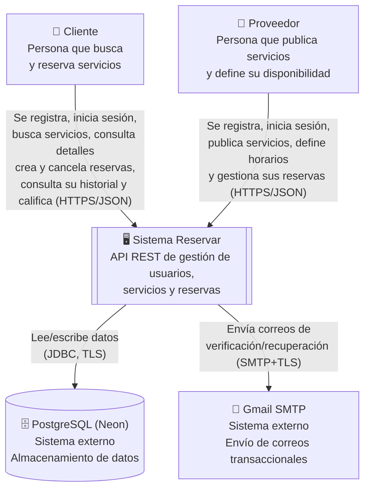
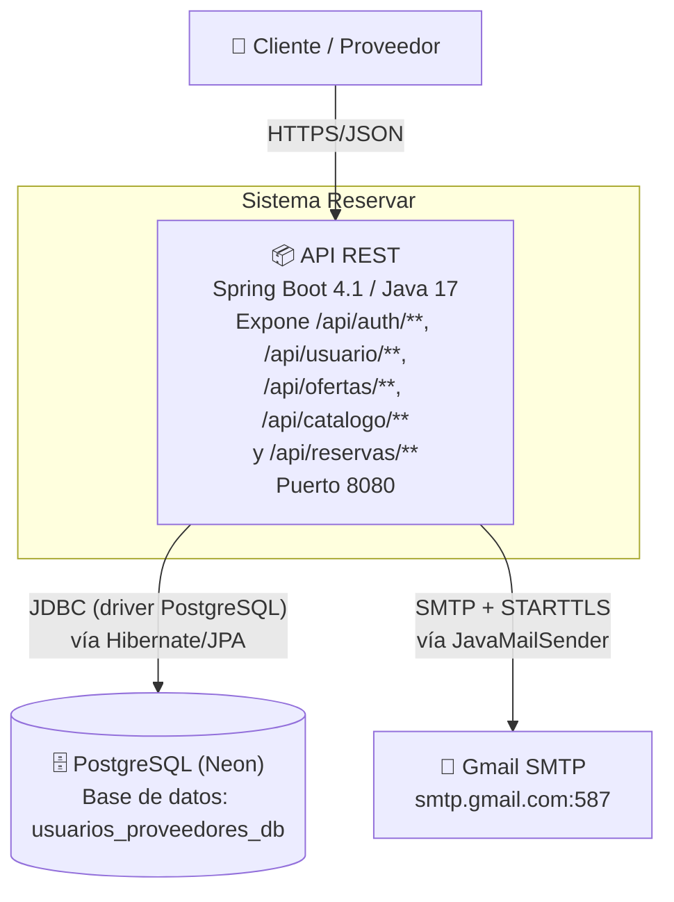
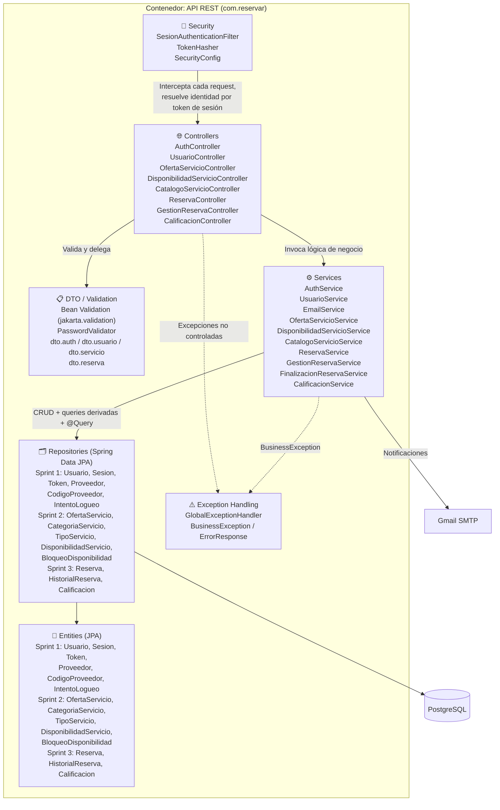
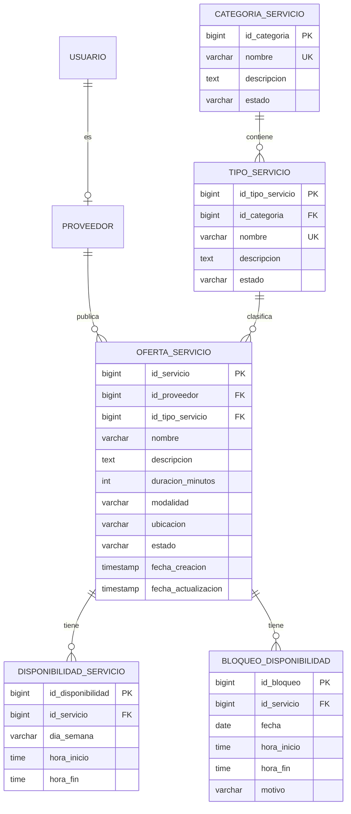
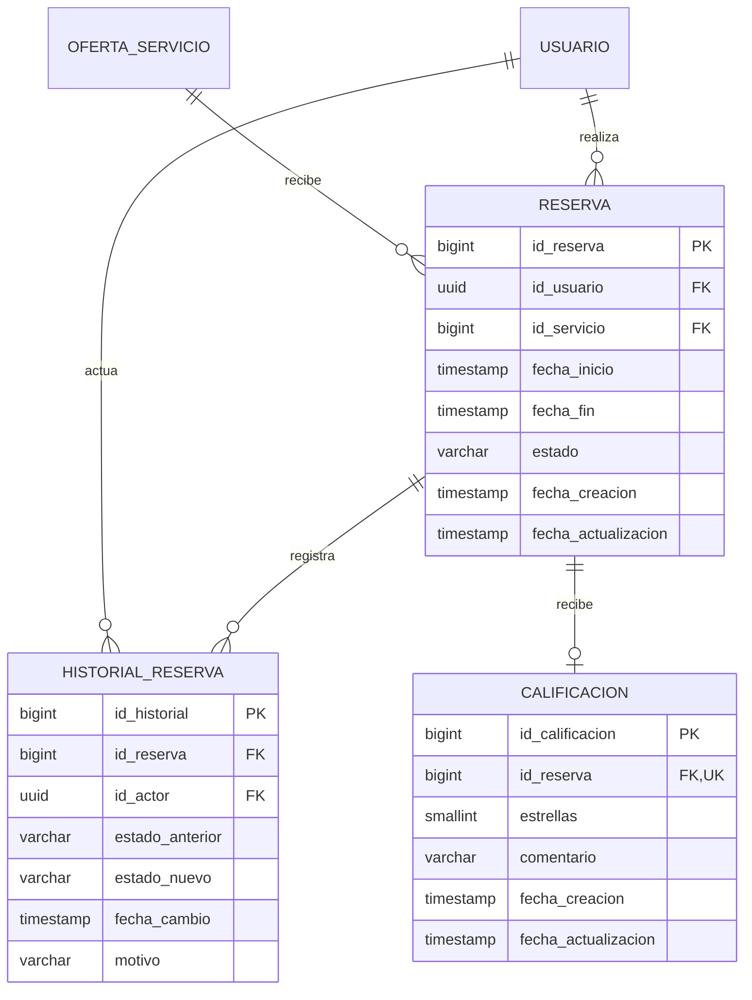
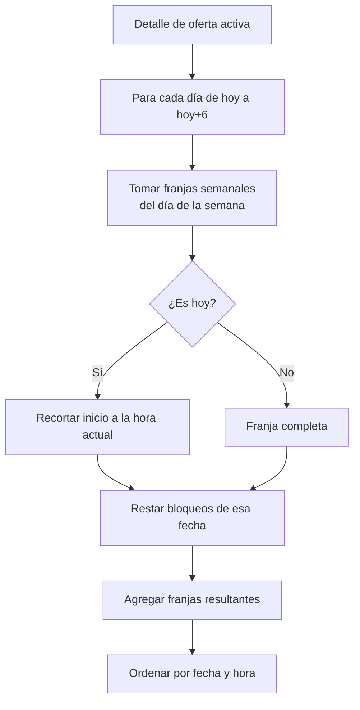

# Arquitectura del sistema — Reservar

**Proyecto:** Reservar. Plataforma de reservas (Fábrica Escuela EAV09).  
**Alcance de este documento:** Épica 1 (Sprint 1), Épica 2 (Sprint 2) y Épica 3 (Sprint 3), con la implementación de HU-11 a HU-15: creación, gestión, historial de reservas y calificaciones. 
**Stack:** Spring Boot 4.1 (Java 17), PostgreSQL (Neon), Spring Security, Spring Data JPA / Hibernate.  
**Última actualización:** 2026-11-10 (documentación de HU-11 a HU-15 y alcance técnico del Sprint 3).

> Este documento no cubre frontend (no hay requerimiento de frontend en el proyecto) ni estrategia de despliegue. Se enfoca en la arquitectura y funcionalidades implementadas en el backend.
>
> La documentación conserva los componentes desarrollados en los Sprints 1 y 2 e incorpora HU-11 a HU-15 del Sprint 3, sin cambiar la arquitectura en capas ni sustituir las funcionalidades anteriores.

---

## Cómo ejecutar el proyecto y las pruebas

Requisitos: JDK 17 o superior. No hace falta instalar Maven (se usa el wrapper `mvnw`).

1. Configurar las siguientes variables de entorno en el sistema, el IDE o la misma terminal desde la que se inicia la aplicación. Un archivo `.env` por sí solo no se carga automáticamente con la configuración actual:

   | Variable | Uso |
      |---|---|
   | `DB_USER`, `DB_PWORD` | Usuario y contraseña de PostgreSQL (Neon) |
   | `MAIL_USER`, `MAIL_PWORD` | Cuenta Gmail SMTP (contraseña de aplicación) para los correos de verificación y recuperación |
   | `SONAR_TOKEN` | Solo en GitHub Actions (secret) para el análisis SonarCloud |

2. Pruebas + cobertura + regla JaCoCo: `./mvnw verify` (reporte en `target/site/jacoco/index.html`).

   Sin `DB_USER`, la prueba de integración `ReservarApplicationTests` se omite y el resto del suite (unitario) corre igual.

3. Levantar la API: `./mvnw spring-boot:run` (puerto 8080).

---

## 1. Introducción

Reservar es una API REST para la gestión de reservas entre **clientes** y **proveedores de servicios**.

- **Sprint 1 (Épica 1):** registro, autenticación, verificación de correo, gestión de perfil y recuperación de contraseña.
- **Sprint 2 (Épica 2):** los proveedores publican y administran sus ofertas de servicio y definen su disponibilidad (franjas semanales y bloqueos de fechas puntuales); los clientes buscan, filtran y consultan el detalle de un servicio con sus próximas franjas disponibles.
- **Sprint 3 (Épica 3, HU-11 a HU-15):** creación de reservas en estado `PENDIENTE` con validación de oferta, fecha y disponibilidad; confirmación o rechazo por el proveedor dueño; cancelación por los participantes; consulta privada y paginada del historial; finalización automática de reservas confirmadas y creación o edición de calificaciones por el cliente que recibió el servicio. Se conserva el control de superposición y se incorpora el promedio y la cantidad de calificaciones en el detalle público de cada oferta.

La arquitectura se documenta siguiendo el modelo **C4** (Contexto, Contenedores, Componentes) y se justifican las decisiones de estilo arquitectónico, persistencia y seguridad.

---

## 2. Diagrama C4 — Nivel 1: Contexto

Muestra el sistema como una caja negra y sus interacciones con actores y sistemas externos.

**Actores y sistemas externos:**

| Elemento | Tipo | Descripción |
|---|---|---|
| Cliente | Persona | Usuario que explora y consume servicios ofrecidos en la plataforma y puede crear reservas |
| Proveedor | Persona | Usuario que ofrece servicios; requiere código de proveedor válido para registrarse y cuenta activa para publicar |
| Sistema Reservar | Sistema de software (este proyecto) | Backend API REST |
| PostgreSQL (Neon) | Sistema externo | Base de datos relacional gestionada, alojada en la nube |
| Gmail SMTP | Sistema externo | Proveedor de correo saliente para verificación, recuperación y confirmación de cambio de correo |

> Fuera de alcance: pagos en línea, notificaciones push/SMS, integración con mapas o geolocalización de terceros (la ubicación se guarda como texto libre) y múltiples sedes por proveedor. Por eso no aparecen nuevos sistemas externos con la incorporación de HU-11 a HU-15.

---

## 3. Diagrama C4 — Nivel 2: Contenedores

Descompone el sistema en los "contenedores" desplegables/ejecutables que lo componen.

**Justificación:** un único contenedor desplegable (monolito modular) sigue siendo suficiente y apropiado para el alcance académico y el tamaño del equipo. Las funcionalidades de autenticación, ofertas, disponibilidad, reservas y calificaciones conviven en el mismo proceso y utilizan la misma base de datos, sin necesidad de incorporar nuevos servicios. En C4, «contenedor» representa una unidad ejecutable; este diagrama no implica que exista una imagen Docker ni un despliegue orquestado.

---

## 4. Diagrama C4 — Nivel 3: Componentes (dentro del contenedor API REST)

**Responsabilidad de cada componente:**

| Componente | Responsabilidad |
|---|---|
| `security` | Autenticación por token de sesión opaco (no JWT); construye el `Authentication` de Spring Security en cada request |
| `controller` | Adaptador HTTP: recibe DTOs validados, delega en el service y traduce el resultado a `ResponseEntity`. Los controladores que requieren identidad extraen el `Usuario` autenticado del `SecurityContext` y lo pasan al servicio |
| `dto` + Bean Validation | Contrato de entrada/salida de la API; validaciones declarativas (`@NotBlank`, `@NotNull`, `@Positive`, `@Size`, etc.) |
| `service` | Reglas de negocio y orquestación de transacciones (`@Transactional`). Aquí viven la autorización por propiedad del recurso, el cálculo de próximas franjas, las transiciones de reservas y las reglas de calificación |
| `repository` | Acceso a datos vía Spring Data JPA; consultas derivadas y consultas `@Query` explícitas |
| `entity` | Modelo de persistencia, mapeado contra el esquema físico de PostgreSQL |
| `exception` | Traducción centralizada de errores de negocio y de validación a respuestas HTTP |

La estructura de paquetes replica una **arquitectura en capas** clásica de Spring Boot: `controller → service → repository → entity`, con paquetes transversales (`security`, `exception`, `config`, `validation`) que no pertenecen a ninguna capa de negocio específica.

En HU-11, `ReservaController` recibe la solicitud de creación, obtiene el usuario autenticado desde `SecurityContextHolder` y delega la operación a `ReservaService`. Este servicio coordina las validaciones y la persistencia mediante los repositorios correspondientes. Las operaciones posteriores se delegan a `GestionReservaService`; `CalificacionService` gestiona las valoraciones y `FinalizacionReservaService` ejecuta la finalización periódica mediante `@Scheduled`, habilitada por `ReservaSchedulingConfig`.

---

## 5. Estilo arquitectónico

**Estilo elegido:** monolito modular en capas, organizado por tipo técnico de componente (`controller`, `service`, `repository`, `entity`) en un único módulo Maven.

**Justificación:**

- El dominio (usuarios, catálogo, disponibilidad y reservas) sigue siendo cohesivo y no presenta necesidad de escalar independientemente sus partes.
- El equipo es pequeño (proyecto académico), por lo que la sobrecarga operativa de microservicios (orquestación, descubrimiento de servicios, comunicación de red, consistencia eventual) no se justifica frente al beneficio.
- Spring Boot favorece este estilo de forma nativa (auto-configuración, un único `ApplicationContext`).
- Los paquetes de ofertas, disponibilidad y reservas conviven con los de usuarios dentro de las mismas carpetas técnicas, apoyándose en una sub-organización por dominio en `dto` (`auth`, `usuario`, `servicio`, `reserva`). Se conserva el monolito modular sin introducir servicios independientes.

---

## 6. Persistencia

- **Tecnología:** Spring Data JPA sobre Hibernate, contra PostgreSQL (Neon, servicio gestionado en la nube).
- **Estrategia de esquema:** `spring.jpa.hibernate.ddl-auto=validate` — el esquema SQL se versiona y gestiona de forma explícita (`ESTRUCTURAS.sql`, DDL escrito a mano, dividido por sprint), y Hibernate únicamente **valida** que las entidades coincidan con él al arrancar. Esto evita que un mapeo incorrecto en el código altere silenciosamente el esquema de una base de datos compartida por el equipo.
- **Tipos de datos especializados usados de PostgreSQL (Sprint 1):**
  - `UUID` como clave primaria en `USUARIO`, `SESION`, `TOKEN` — evita IDs secuenciales predecibles en identificadores expuestos externamente.
  - `CITEXT` en `correo` y `correo_pendiente` — comparaciones case-insensitive nativas en BD.
  - `INET` en `ip_origen` (`INTENTOS_LOGUEO`, `SESION`) — validación de formato de IP a nivel de motor. Mapeado en JPA con `columnDefinition` + `@ColumnTransformer(write = "?::inet")`.

### 6.1 Modelo de datos del Sprint 2

**Decisiones de modelado y restricciones en base de datos (Sprint 2):**

| Decisión | Detalle |
|---|---|
| Catálogo en dos niveles | `CATEGORIA_SERVICIO` (lista cerrada: SALUD, BELLEZA, DEPORTE, BIENESTAR, EDUCACION, HOGAR) → `TIPO_SERVICIO` (ej. Odontología, Yoga). La oferta referencia el **tipo**; la categoría se deriva. Ambos se pueblan con datos iniciales en `ESTRUCTURAS.sql` |
| Tipo de servicio solo vía catálogo | `PROVEEDOR` ya **no** tiene `tipo_servicio` (texto libre): el tipo de servicio se expresa únicamente a través de `OFERTA_SERVICIO.id_tipo_servicio` (ver ADR-06) |
| Desactivación lógica | `OFERTA_SERVICIO.estado` (`ACTIVO`/`INACTIVO`): nunca se borra una oferta, así se conserva el historial que Sprint 3 asociará a ella |
| Ubicación condicional | `CHECK chk_oferta_ubicacion`: si `modalidad = 'PRESENCIAL'`, `ubicacion` es obligatoria y no vacía; si es `REMOTO`, puede ser nula |
| Franjas coherentes | `CHECK hora_inicio < hora_fin` en `DISPONIBILIDAD_SERVICIO` y `BLOQUEO_DISPONIBILIDAD` |
| Sin traslapes (franjas) | `EXCLUDE USING gist` sobre (`id_servicio`, `dia_semana`, rango de horas `[)`) — requiere la extensión `btree_gist`. Es la garantía final contra condiciones de carrera; el servicio valida antes para devolver un mensaje específico |
| Índices | `idx_oferta_proveedor`, `idx_oferta_tipo_servicio`, `idx_oferta_estado`, `idx_tipo_servicio_categoria`, `idx_disponibilidad_servicio_dia`, `idx_bloqueo_servicio_fecha`, creados según los patrones de consulta de búsqueda y de cálculo de disponibilidad |
| Bloqueo como excepción puntual | `BLOQUEO_DISPONIBILIDAD` es independiente de la configuración recurrente: bloquear una fecha no elimina ni modifica las franjas semanales. `motivo` admite `RESERVADO` y `OTRO` |

### 6.2 Modelo de datos del Sprint 3 (HU-11 a HU-15)

El modelo utiliza `RESERVA`, `HISTORIAL_RESERVA` y `CALIFICACION`, respetando los nombres del modelo E-R de la entrega de base de datos. La incorporación de las funcionalidades no ejecuta DDL nuevo: el esquema debe existir y Hibernate lo valida al iniciar.

**Responsabilidad de las entidades:**

- `RESERVA`: almacena las solicitudes de reserva realizadas por los clientes, relacionándolas con el usuario y la oferta de servicio correspondiente.
- `HISTORIAL_RESERVA`: registra los cambios de estado asociados a una reserva, incluyendo el actor responsable, el estado anterior, el nuevo estado y la fecha del cambio.

- `CALIFICACION`: guarda una única valoración por reserva, con estrellas, comentario opcional y marcas de creación/actualización; el cliente y la oferta se obtienen a través de la reserva.

**Decisiones de modelado y restricciones del Sprint 3:**

| Decisión | Detalle |
|---|---|
| Identificador de reserva | `id_reserva` utiliza una clave primaria `BIGINT` autogenerada |
| Relación con el cliente | `RESERVA.id_usuario` referencia a `USUARIO`; la identidad se obtiene del usuario autenticado y no se recibe en el cuerpo de la solicitud |
| Relación con la oferta | `RESERVA.id_servicio` referencia a `OFERTA_SERVICIO` |
| Intervalo válido | Se exige que `fecha_fin` sea posterior a `fecha_inicio` |
| Estados de reserva | Se contemplan `PENDIENTE`, `CONFIRMADA`, `RECHAZADA`, `CANCELADA` y `COMPLETADA` |
| Estado inicial | Las reservas creadas mediante HU-11 comienzan en estado `PENDIENTE` |
| Control de superposición | La restricción `ex_reserva_horario` utiliza `EXCLUDE USING GIST` sobre la oferta y el intervalo `tsrange(fecha_inicio, fecha_fin, '[)')`, considerando únicamente reservas `PENDIENTE` y `CONFIRMADA` |
| Intervalos semiabiertos | El uso de `[)` permite reservas consecutivas: una reserva puede terminar exactamente cuando comienza la siguiente |
| Historial inicial | Al crear una reserva se registra un evento en `HISTORIAL_RESERVA`, con `estado_anterior` nulo y `estado_nuevo = 'PENDIENTE'` |
| Transiciones y auditoría | Confirmar, rechazar y cancelar actualiza la reserva y registra actor, fecha, estados y motivo en una misma transacción |
| Serialización de operaciones | `PESSIMISTIC_WRITE` bloquea la fila de la reserva durante las transiciones manuales y la creación/edición de calificaciones |
| Calificación única | `CALIFICACION.id_reserva` es una FK única; una segunda creación se rechaza y la edición conserva el mismo registro |
| Promedio por oferta | `AVG` y `COUNT` se calculan desde las calificaciones asociadas a las reservas de la oferta; sin valoraciones, el promedio es `null` y la cantidad es `0` |

La restricción de exclusión constituye la garantía final frente a solicitudes concurrentes que intenten ocupar el mismo intervalo para una oferta. La validación también se realiza desde el servicio para proporcionar una respuesta de negocio específica cuando el horario ya está ocupado.

---

## 7. Seguridad

### 7.1 Autenticación

- **Hash de contraseñas:** BCrypt (`BCryptPasswordEncoder`), costo por defecto — nunca se almacena contraseña en texto plano (`USUARIO.hash_contrasena`).
- **Sesiones por token opaco (no JWT):** al iniciar sesión se genera un token aleatorio de 256 bits (`SecureRandom`), se persiste su **hash SHA-256** en la tabla `SESION`, y el token en texto plano se entrega una única vez al cliente. Cada request posterior envía `Authorization: Bearer <token>`; un filtro (`SesionAuthenticationFilter`) lo hashea, busca la sesión activa y no expirada, y construye el `Authentication` de Spring Security con el `Usuario` correspondiente.
- **Justificación de tokens opacos server-side vs JWT:** la sesión se puede revocar de inmediato (cambio de contraseña, cierre forzado) porque el servidor es la fuente de verdad; con JWT autocontenido habría que mantener una lista de revocación o aceptar una ventana de validez. Además, una filtración de la tabla `SESION` no expone tokens utilizables, porque solo se guarda su hash.
- **Expiración diferenciada por tipo de token** (tabla `TOKEN.tipo`):

  | Tipo | Expira en | Uso |
    |---|---|---|
  | `VERIFICACION` | 24 horas | Activar cuenta tras registro |
  | `RECUPERACION` | 1 hora | Restablecer contraseña olvidada |
  | `ACTUALIZACION` | 1 hora | Confirmar cambio de correo electrónico |
  | Sesión (`SESION`) | 24 horas | Autenticación en cada request |

- **Mitigación de fuerza bruta:** bloqueo temporal de 15 minutos tras 5 intentos fallidos consecutivos (`USUARIO.intentos_fallidos`, `USUARIO.bloqueado_hasta`), con auditoría de cada intento (exitoso o no) en `INTENTOS_LOGUEO`, incluyendo IP de origen y user-agent.
- **Invalidación de sesiones:** al confirmar un cambio de contraseña, todas las sesiones activas del usuario se revocan (`SESION.fecha_revocacion`).

### 7.2 Autorización (RBAC + propiedad del recurso)

La autorización se aplica de acuerdo con el tipo de operación y el rol del usuario autenticado.

**Operaciones de ofertas y disponibilidad:**

1. **Filtro de rutas (`SecurityConfig`).** Las consultas `GET` públicas de ofertas, disponibilidad, bloqueos y catálogo pueden ser consultadas sin sesión. Las operaciones de escritura exigen sesión válida. Sin sesión → **401**.
2. **Reglas del servicio.** Los métodos de escritura de `OfertaServicioService` y `DisponibilidadServicioService` verifican:
  1. que el usuario esté autenticado;
  2. que tenga `rol == PROVEEDOR`;
  3. que su cuenta tenga `estado == ACTIVO`;
  4. que la oferta pertenezca al proveedor autenticado.
3. **Traducción a HTTP (`GlobalExceptionHandler`).** Los códigos de autenticación y autorización se traducen a los estados HTTP correspondientes.

**Operación de creación de reservas (HU-11):**

- La creación de reservas requiere un usuario autenticado con perfil `CLIENTE`.
- El controlador `ReservaController` obtiene el usuario autenticado desde `SecurityContextHolder` y lo entrega a `ReservaService`.
- La identidad del cliente se obtiene del token de sesión. No se recibe un `id_usuario` ni un identificador de cliente en el cuerpo de la solicitud.
- Los perfiles `CLIENTE` y `PROVEEDOR` son mutuamente excluyentes. Por el flujo normal de autenticación, un proveedor no puede realizar reservas como cliente. La validación de autorreserva se mantiene como una protección adicional.

**Gestión, consultas y calificaciones (HU-12 a HU-15):**

- Todas las rutas de reservas y calificaciones requieren un token de sesión válido y las operaciones comprueban que la cuenta esté activa.
- Solo el proveedor dueño de la oferta puede confirmar o rechazar una reserva pendiente. El cliente dueño puede cancelar una reserva `PENDIENTE` o `CONFIRMADA`; el proveedor dueño solo puede cancelar una reserva `CONFIRMADA`. En ambos casos, la fecha de finalización debe ser futura.
- Las consultas de listado, detalle y auditoría se limitan a las reservas en las que participa el usuario autenticado. No existe una consulta pública del historial.
- Solo el cliente dueño puede crear o editar la calificación de una reserva `COMPLETADA`. La identidad no se recibe en el cuerpo de la petición.
- Un participante ajeno recibe `403`; un recurso inexistente, `404`; una transición no permitida, `400`; una calificación duplicada, `409`.

**Roles del dominio:** `CLIENTE`, `PROVEEDOR` (enum `Rol`, columna `USUARIO.rol`), traducidos a `ROLE_CLIENTE` / `ROLE_PROVEEDOR` por el filtro de autenticación.

### 7.3 Control de permisos por endpoint (estado actual)

**Sprint 1**

| Endpoint | Método | Acceso | Notas |
|---|---|---|---|
| `/api/auth/registro/cliente` | POST | Público | — |
| `/api/auth/registro/proveedor` | POST | Público | Requiere código de proveedor válido y no usado |
| `/api/auth/verificar/{token}` | GET | Público | Token de un solo uso, expira en 24h |
| `/api/auth/verificar/reenviar` | POST | Público | Reenvío del correo de verificación |
| `/api/auth/login` | POST | Público | Registra intento en `INTENTOS_LOGUEO`, bloqueo tras 5 fallos |
| `/api/auth/recuperacion/solicitar` | POST | Público | No revela si el correo existe |
| `/api/auth/recuperacion/confirmar` | POST | Público | Token de un solo uso, expira en 1h; revoca sesiones activas |
| `/api/usuario/perfil` | GET / PUT | Autenticado (cualquier rol) | Solo opera sobre el propio usuario. Sin sesión: 401 |
| `/api/usuario/correo/confirmar/{token}` | GET | Público | Token de un solo uso, expira en 1h |

**Sprint 2**

| Endpoint | Método | Quién puede usarlo | Notas |
|---|---|---|---|
| `/api/catalogo/categorias` | GET | Cualquiera | Categorías activas |
| `/api/catalogo/tipos-servicio` | GET | Cualquiera | Todos los tipos de servicio activos (incluye `idCategoria` y nombre de la categoría) |
| `/api/catalogo/categorias/{idCategoria}/tipos-servicio` | GET | Cualquiera | Tipos activos de una categoría |
| `/api/ofertas` | GET | Cualquiera | Búsqueda paginada; params `texto`, `idCategoria`, `page`, `size`, `sort`. Solo ofertas activas |
| `/api/ofertas/{id}` | GET | Cualquiera | Detalle + `proximasDisponibilidades` (7 días). Solo ofertas activas |
| `/api/ofertas/{idServicio}/disponibilidad` | GET | Cualquiera | Franjas semanales de una oferta activa |
| `/api/ofertas/{idServicio}/bloqueos` | GET | Cualquiera | Filtros opcionales `fechaInicio`, `fechaFin` (ISO `yyyy-MM-dd`) |
| `/api/ofertas` | POST | Proveedor activo (401 sin sesión, 403 si es cliente) | Publica una oferta (queda `ACTIVO`) |
| `/api/ofertas/{id}` | PUT | Proveedor activo, dueño (403 si no lo es) | Edita tipo, nombre, descripción, duración, modalidad, ubicación |
| `/api/ofertas/{id}/desactivar` | PATCH | Proveedor activo, dueño | Desactivación lógica (`INACTIVO`) |
| `/api/ofertas/mis-ofertas` | GET | Proveedor activo | Ofertas **activas** propias, paginadas |
| `/api/ofertas/mis-ofertas/historial` | GET | Proveedor activo | **Todas** las ofertas propias (activas e inactivas), paginadas, más recientes primero |
| `/api/ofertas/{idServicio}/disponibilidad` | POST | Proveedor activo, dueño | Valida `inicio < fin` y ausencia de traslape |
| `/api/ofertas/{idServicio}/disponibilidad/{id}` | DELETE | Proveedor activo, dueño | — |
| `/api/ofertas/{idServicio}/bloqueos` | POST | Proveedor activo, dueño | Bloquea una fecha. Sin `horaInicio` ni `horaFin` bloquea el día completo; `motivo` es opcional (por defecto `OTRO`). No admite fechas pasadas |
| `/api/ofertas/{idServicio}/bloqueos/{id}` | DELETE | Proveedor activo, dueño | — |

**Sprint 3, HU-11 a HU-15**

| Endpoint | Método | Quién puede usarlo | Notas |
|---|---|---|---|
| `/api/reservas` | POST | Cliente autenticado | Crea una reserva `PENDIENTE`; valida oferta, fecha futura, disponibilidad y conflictos de horario. Responde `201` |
| `/api/reservas/{idReserva}/confirmar` | PATCH | Proveedor activo dueño de la oferta | Solo desde `PENDIENTE`; responde `200` |
| `/api/reservas/{idReserva}/rechazar` | PATCH | Proveedor activo dueño de la oferta | Solo desde `PENDIENTE`; cuerpo opcional con `motivo` de hasta 255 caracteres |
| `/api/reservas/{idReserva}/cancelar` | PATCH | Cliente dueño o proveedor dueño, cuenta activa | Cliente: desde `PENDIENTE` o `CONFIRMADA`. Proveedor: solo desde `CONFIRMADA`. En ambos casos, `fechaFin` futura; motivo opcional |
| `/api/reservas` o `/api/reservas/historial` | GET | Participante activo | Ambas rutas devuelven el mismo listado propio paginado; filtro opcional `estado`, parámetros `page`, `size`, `sort`; orden predeterminado `fechaInicio DESC` |
| `/api/reservas/{idReserva}` | GET | Participante activo | Detalle privado de una reserva |
| `/api/reservas/{idReserva}/historial` | GET | Participante activo | Auditoría de cambios, ordenada por fecha |
| `/api/reservas/{idReserva}/calificacion` | POST | Cliente activo dueño de la reserva completada | `estrellas` de 1 a 5 y `comentario` opcional de hasta 500 caracteres; responde `201`, duplicado `409` |
| `/api/reservas/{idReserva}/calificacion` | PUT | Cliente activo dueño de la reserva completada | Edita la calificación existente; responde `200`, inexistente `404` |

`GET /api/reservas/historial` es un alias compatible del listado existente `GET /api/reservas`; no requiere ni acepta una identidad de otro usuario para ampliar su alcance. Se diferencia de `GET /api/reservas/{idReserva}/historial`, que devuelve la auditoría de una sola reserva y exige ser participante.

**Criterio de HU-13 pendiente de acuerdo:** las tareas solicitan estados distintos según el actor, pero el dominio de estados de la BD admite únicamente `CANCELADA`. La implementación mantiene ese estado y registra el actor en auditoría; no se declara cumplida literalmente la distinción de estados hasta que el equipo acepte ese criterio o autorice una migración coordinada. No se ha modificado el esquema para introducir estados nuevos.

El detalle público existente `GET /api/ofertas/{id}` incorpora `promedioCalificacion` y `numeroCalificaciones`, calculados por oferta, no como promedio global del proveedor. La finalización automática es una tarea interna: no se añade un endpoint para forzar `COMPLETADA`.

---

## 8. Manejo de errores

- **Centralizado** mediante `@RestControllerAdvice` (`GlobalExceptionHandler`), en lugar de manejo ad-hoc por controller.
- **Contrato de error de negocio** (`ErrorResponse`): `codigo` (string simbólico, ej. `OFERTA_NO_PROPIA`), `mensaje` (texto para el usuario), `fecha`, y `errores` (lista opcional, usada en errores de validación campo por campo).
- **`BusinessException`** — excepción de dominio con código simbólico, lanzada por la capa de servicio cuando se viola una regla de negocio. Los estados HTTP dependen del mapeo definido en el manejo centralizado de excepciones.
- **Rechazos del filtro de seguridad:** los 401/403 que decide `SecurityConfig` antes de llegar a un controller (por ejemplo, un POST sin sesión) se emiten con `sendError`, por lo que el cuerpo es el estándar de Spring Boot y no el contrato `ErrorResponse`.
- **Errores de validación de Bean Validation** (`MethodArgumentNotValidException`, `ConstraintViolationException`) se interceptan aparte y se listan campo por campo en `errores` (ej. `fechaInicio: La fecha de inicio debe ser futura`), sin exponer detalles internos de Hibernate/Spring.

**Códigos de error de la Épica 2:**

| Código | Situación |
|---|---|
| `USUARIO_NO_AUTENTICADO` (401) | No hay sesión válida al operar sobre ofertas/disponibilidad |
| `ROL_NO_AUTORIZADO` (403) | Un cliente intenta publicar o gestionar |
| `PROVEEDOR_NO_ACTIVO` | Cuenta del proveedor no activa/verificada |
| `PROVEEDOR_NO_ENCONTRADO` | El usuario con rol proveedor no tiene registro en `PROVEEDOR` |
| `OFERTA_NO_PROPIA` (403) | Se intenta modificar una oferta de otro proveedor |
| `OFERTA_NO_ENCONTRADA` / `OFERTA_NO_DISPONIBLE` | Oferta inexistente, inactiva o con catálogo inactivo |
| `TIPO_SERVICIO_NO_ENCONTRADO` / `TIPO_SERVICIO_INACTIVO` / `CATEGORIA_INACTIVA` / `CATEGORIA_NO_ENCONTRADA` | Catálogo inválido |
| `MODALIDAD_INVALIDA` / `UBICACION_REQUERIDA` | Modalidad fuera de {PRESENCIAL, REMOTO} o presencial sin ubicación |
| `NOMBRE_REQUERIDO` / `DESCRIPCION_REQUERIDA` / `DURACION_INVALIDA` | Campos obligatorios |
| `DIA_SEMANA_INVALIDO` / `INTERVALO_HORARIO_INVALIDO` | Franja mal formada |
| `DISPONIBILIDAD_TRASLAPADA` / `BLOQUEO_TRASLAPADO` | Traslape con otra franja o bloqueo |
| `FECHA_BLOQUEO_INVALIDA` / `MOTIVO_BLOQUEO_INVALIDO` / `RANGO_FECHAS_INVALIDO` | Bloqueos y filtros de fecha inválidos |
| `DISPONIBILIDAD_NO_ENCONTRADA` / `DISPONIBILIDAD_NO_PERTENECE` / `BLOQUEO_NO_ENCONTRADO` / `BLOQUEO_NO_PERTENECE` | Recurso inexistente o de otra oferta |

**Códigos de error verificados para HU-11:**

| Código | Situación |
|---|---|
| `DATOS_INVALIDOS` | La fecha de inicio no es futura o existen errores de validación en los datos enviados |
| `OFERTA_NO_DISPONIBLE` | La oferta no existe o no está activa |
| `FUERA_DE_DISPONIBILIDAD` | El horario solicitado está fuera de la disponibilidad configurada para el servicio |
| `HORARIO_NO_DISPONIBLE` | Ya existe una reserva para la oferta en el horario solicitado |
| `401 Unauthorized` | Solicitud sin autenticación válida; el rechazo se produce en el filtro de seguridad |

**Códigos incorporados para HU-12 a HU-15:**

| Código | HTTP | Situación |
|---|---|---|
| `RESERVA_NO_ENCONTRADA` / `CALIFICACION_NO_ENCONTRADA` | 404 | Reserva inexistente o calificación aún no creada |
| `RESERVA_NO_PROPIA` / `ROL_NO_AUTORIZADO` | 403 | Usuario ajeno o rol sin permiso para la operación |
| `ESTADO_RESERVA_INVALIDO` | 400 | Transición no permitida o intento de calificar una reserva no completada |
| `CALIFICACION_EXISTENTE` | 409 | Segunda creación de calificación para la misma reserva |
| `MOTIVO_INVALIDO` / `ESTRELLAS_INVALIDAS` / `COMENTARIO_INVALIDO` | 400 | Motivo mayor de 255 caracteres, estrellas fuera de 1 a 5 o comentario mayor de 500 caracteres |

El manejo centralizado de errores evita duplicar `try/catch` en cada controller, mantiene respuestas controladas y aísla la capa de negocio de los detalles del protocolo HTTP. Los rechazos de Spring Security pueden utilizar una estructura distinta a `ErrorResponse`, según el punto en el que se rechace la solicitud.

---

## 9. Reglas de negocio (más allá de CRUD)

### Épica 1 (Sprint 1)

1. **Ciclo de vida de la cuenta:** `PENDIENTE → ACTIVO` (solo vía verificación de correo con token válido y no expirado) y `ACTIVO → INACTIVO` (reservado para administración, fuera de alcance).
2. **Bloqueo temporal por fuerza bruta:** 5 intentos fallidos consecutivos bloquean la cuenta 15 minutos, con reseteo del contador al expirar el bloqueo o al autenticarse con éxito.
3. **Códigos de proveedor de un solo uso:** `DISPONIBLE → USADO` al registrarse un proveedor, o `DISPONIBLE → EXPIRADO` si su fecha de expiración ya pasó; en ambos casos el registro se rechaza.
4. **Cambio de correo con doble confirmación:** el nuevo correo queda en `correo_pendiente` y solo reemplaza a `correo` tras confirmar un token enviado al correo *nuevo*.
5. **Invalidación en cascada de sesiones:** un cambio de contraseña por recuperación revoca todas las sesiones activas.
6. **Tokens de un solo uso con expiración diferenciada por propósito** (ver tabla en sección 7.1).

### Épica 2 (Sprint 2)

7. **Publicar requiere proveedor activo:** solo `rol = PROVEEDOR` con cuenta `ACTIVO` y con registro en `PROVEEDOR` puede crear, editar o desactivar ofertas y gestionar su disponibilidad.
8. **Oferta ligada a un catálogo vigente:** el tipo de servicio debe existir y estar activo, y su categoría también. Si el catálogo se desactiva después, la oferta deja de ser visible (búsqueda, detalle y disponibilidad pública) aunque su propio estado siga en `ACTIVO`.
9. **Modalidad y ubicación:** `PRESENCIAL` exige ubicación; `REMOTO` no. Se valida en el servicio y en un `CHECK` de base de datos.
10. **Desactivación lógica:** desactivar una oferta cambia su estado, la saca de búsquedas y del detalle público, y conserva el registro y sus franjas para el historial.
11. **Sin traslapes de franjas:** dos franjas del mismo servicio y día no pueden solaparse (intervalos semiabiertos `[inicio, fin)`: una franja que termina a las 10:00 y otra que empieza a las 10:00 son válidas). Validación en el servicio + `EXCLUDE` en BD.
12. **Bloqueos de fechas puntuales:** no se pueden crear en fechas pasadas ni traslaparse entre sí en la misma fecha. No modifican la configuración semanal. Si se omiten las horas, el bloqueo cubre el día completo y se guarda como 00:00 a 23:59:59.999999 (sin cambios en el esquema).
13. **Visibilidad de ofertas para el proveedor:** `mis-ofertas` muestra solo las activas; `mis-ofertas/historial` muestra todas las propias, incluidas las desactivadas, para que el proveedor pueda consultar lo que dejó de ofrecer.
14. **Cálculo de próximas franjas (HU-10):** para el detalle de una oferta se recorren los próximos 7 días (hoy + 6), se toman las franjas semanales del día correspondiente, se recorta la parte ya transcurrida si es hoy, y se **descuentan** los bloqueos de esa fecha (un bloqueo parcial parte la franja en dos). Los resultados se ordenan por fecha y hora.

### Épica 3, Sprint 3 (HU-11 a HU-15)

15. **Creación de reservas por clientes:** únicamente los usuarios autenticados con perfil `CLIENTE` pueden crear reservas mediante el flujo normal de autenticación. Los perfiles `CLIENTE` y `PROVEEDOR` son mutuamente excluyentes.
16. **Validación de fecha:** la fecha de inicio solicitada debe ser futura.
17. **Oferta disponible:** la oferta debe existir y encontrarse activa para permitir la creación de una reserva.
18. **Validación de disponibilidad:** el intervalo solicitado debe encontrarse dentro de las franjas de disponibilidad configuradas para la oferta y no puede coincidir con un bloqueo existente.
19. **Duración de la reserva:** la fecha de finalización se calcula automáticamente a partir de la fecha de inicio y la duración definida en la oferta de servicio.
20. **Estado inicial:** toda reserva creada mediante HU-11 comienza en estado `PENDIENTE`.
21. **Ocupación del horario:** las reservas `PENDIENTE` y `CONFIRMADA` ocupan el intervalo solicitado e impiden nuevas reservas superpuestas.
22. **Trazabilidad inicial:** al crear una reserva se registra su evento inicial en `HISTORIAL_RESERVA`, con estado anterior nulo y estado nuevo `PENDIENTE`.
23. **Control de concurrencia:** la restricción de exclusión de PostgreSQL evita que dos solicitudes concurrentes registren reservas superpuestas para la misma oferta, incluso si ambas superan las validaciones previas del servicio.
24. **Confirmación y rechazo (HU-12):** solo el proveedor dueño puede pasar una reserva `PENDIENTE` a `CONFIRMADA` o `RECHAZADA`. Una reserva rechazada deja de ocupar el horario.
25. **Cancelación (HU-13):** el cliente dueño puede cancelar una reserva `PENDIENTE` o `CONFIRMADA`; el proveedor dueño solo puede cancelar una reserva `CONFIRMADA`. En ambos casos, la fecha de finalización debe ser futura. Se rechazan cancelaciones de reservas rechazadas, canceladas o completadas. El estado resultante es `CANCELADA` para ambos actores; quién canceló queda registrado en la auditoría.
26. **Auditoría manual atómica:** confirmar, rechazar y cancelar registra actor autenticado, estados, momento y motivo en la misma transacción que actualiza la reserva. No se elimina físicamente la reserva al liberar su horario.
27. **Historial privado (HU-14):** cada participante consulta únicamente sus reservas; el listado es paginado y admite filtro por estado. El detalle y la auditoría también comprueban propiedad.
28. **Finalización automática:** con la aplicación en ejecución, una tarea con `fixedDelay = 30000` actualiza a `COMPLETADA` las reservas `CONFIRMADA` cuya `fechaFin` ya llegó. Utiliza el `Clock` de `America/Bogota`; no existe un endpoint público para adelantar el estado.
29. **Límite de auditoría automática:** `HISTORIAL_RESERVA.id_actor` es obligatorio y no hay un actor de sistema definido. La finalización automática actualiza estado y fecha de la reserva, pero no inventa un usuario ni inserta un evento de historial. La trazabilidad completa de esa transición queda pendiente de una decisión de modelado.
30. **Calificación (HU-15):** solo el cliente activo dueño de una reserva `COMPLETADA` puede valorarla, con estrellas de 1 a 5 y comentario opcional de hasta 500 caracteres. No se califica una reserva pendiente, rechazada o cancelada.
31. **Edición sin duplicación:** solo existe una calificación por reserva; `POST` duplicado responde `409` y `PUT` actualiza el registro existente. Se bloquea la fila de la reserva durante ambas operaciones.
32. **Resumen público por oferta:** el detalle agrega `promedioCalificacion` y `numeroCalificaciones`; editar una valoración actualiza el promedio sin incrementar el conteo.

---

## 10. Trazabilidad con las historias de usuario

| HU | Implementación | Estado |
|---|---|---|
| **HU-01 a HU-05** | Registro, autenticación, verificación de correo, gestión de perfil y recuperación de contraseña | Implementadas en el Sprint 1 |
| **HU-06** Publicación de servicios | `POST /api/ofertas` → `OfertaServicioService.crearOferta`; lista predefinida en `GET /api/catalogo/**` | Implementada. La categoría se elige indirectamente vía `idTipoServicio` (la categoría se deriva del tipo). Un cliente que intenta publicar recibe 403 |
| **HU-07** Edición y desactivación | `PUT /api/ofertas/{id}`, `PATCH /api/ofertas/{id}/desactivar` | Implementada. Sin sesión: 401; oferta ajena: 403 |
| **HU-08** Disponibilidad | `POST/DELETE …/disponibilidad`, `POST/DELETE …/bloqueos` | Implementada. El bloqueo admite día completo (sin horas) o un rango horario |
| **HU-09** Búsqueda y filtrado | `GET /api/ofertas?texto=&idCategoria=&page=&size=` | Implementada, paginada. Sin resultados devuelve 200 con página vacía y el campo `mensaje` ("No se encontraron servicios que coincidan con la búsqueda."); con resultados `mensaje` es `null` |
| **HU-10** Detalle y disponibilidad | `GET /api/ofertas/{id}` con `proximasDisponibilidades` | Implementada. Servicio inexistente o inactivo responde con `OFERTA_NO_DISPONIBLE`. Sprint 3 añade promedio y cantidad de calificaciones por oferta; no un promedio global del proveedor |
| **HU-11** Creación de reservas | `POST /api/reservas` → `ReservaService.crearReserva` | Implementada. Valida autenticación, oferta activa, fecha futura, disponibilidad y conflictos de horario. Crea la reserva en estado `PENDIENTE` y registra el evento inicial en `HISTORIAL_RESERVA`. Se verificó mediante pruebas en Postman, incluida una prueba de concurrencia |

### Responsables y alcance del Sprint 3

| HU | Responsable | Implementación |
|---|---|---|
| **HU-11** Creación de reservas | Diego | `ReservaController` y `ReservaService`; creación `PENDIENTE`, validación de horario e historial inicial |
| **HU-12** Confirmación y rechazo | Sebastián | `GestionReservaController` y `GestionReservaService`; proveedor dueño, estados válidos y liberación del horario al rechazar |
| **HU-13** Cancelación y auditoría | Jerónimo | Cancelación por los participantes, liberación del horario y registro transaccional del cambio |
| **HU-14** Historial de reservas | Sebastián | Listado propio paginado y filtrado, detalle privado y consulta de auditoría; finalización automática de confirmadas vencidas |
| **HU-15** Calificaciones | Luis Fernando | `CalificacionController` y `CalificacionService`; creación/edición por reserva completada y resumen público por oferta |

Estas funcionalidades están implementadas en el código. La evidencia de pruebas y las limitaciones de la validación se describen a continuación; la implementación no implica que todos los escenarios de integración con PostgreSQL hayan sido certificados.

### Requisitos no funcionales

| Requisito | Cómo se cumple |
|---|---|
| Autorización de propiedad en el servidor | `obtenerOfertaPropia` / `obtenerOfertaPropiaActiva` en los services |
| Búsquedas paginadas | `Pageable` con `@PageableDefault(size = 10, sort = fechaCreacion DESC)` y `@Query` que devuelve `Page` |
| Franjas sin traslape, validadas en el servidor | Validación en `DisponibilidadServicioService` + restricción `EXCLUDE` en BD |
| Identidad del cliente en la creación de reservas | Se obtiene del `SecurityContext` mediante el token de sesión, no de un identificador enviado por el cliente |
| Prevención de reservas superpuestas | Validación de negocio en el servicio y restricción de exclusión GiST en PostgreSQL |
| Trazabilidad de la creación | Registro del evento inicial de la reserva en `HISTORIAL_RESERVA` |
| Transiciones manuales consistentes | Bloqueo pesimista de la reserva y auditoría en una misma transacción |
| Privacidad de reservas | Listado por participante y validación de propiedad en detalle e historial |
| Integridad de calificaciones | Una calificación por reserva, validación de estado completado, propiedad y rango de estrellas |

---

### Criterios técnicos del Sprint 3 y evidencia disponible

| Criterio | Estado documentado |
|---|---|
| Refinamiento de APIs | Se amplía `/api/reservas` con transiciones, consultas privadas, paginación, filtro por estado y calificaciones. Se conservan las rutas existentes y el manejo centralizado de errores |
| Contenedores y orquestación, cuando aplique | Se conserva el monolito en un único proceso Spring Boot. No hay configuración de Docker, Compose ni Kubernetes en la revisión; no se declara un despliegue contenerizado u orquestado |
| Observabilidad con Grafana/Prometheus | No implementada en esta entrega: no se encontraron dependencias de Actuator/Micrometer Prometheus ni configuración de recolección o paneles. JaCoCo y SonarCloud son herramientas de calidad, no sustituyen la observabilidad operativa |
| Pruebas de integración | Hay pruebas HTTP/seguridad con MockMvc y `@WebMvcTest`, con servicios simulados. Existe una prueba `@SpringBootTest` de carga de contexto, condicionada a `DB_USER`, que requiere conexión real. No equivale a una suite completa de integración JPA/concurrencia de HU-12 a HU-15 |
| Aseguramiento mediante tokens | Se reutilizan los tokens de sesión opacos, hash SHA-256, expiración y revocación. Las operaciones de reservas validan identidad, rol, cuenta activa y propiedad. No se introduce JWT ni se expone un endpoint público para consultar reservas privadas |

### Pruebas y límites de validación

- Se añadieron pruebas de servicios, controladores y autorización para gestión de reservas y calificaciones. Cubren transiciones, propiedad, restricciones de calificación y acceso sin sesión.
- Tras añadir el alias de historial se ejecutaron **88 pruebas seleccionadas de reservas, calificaciones, seguridad y ofertas: todas aprobadas**. La verificación completa local contabilizó **424 pruebas: 422 aprobadas, 1 fallo preexistente y 1 omitida**. Se añadieron cuatro casos nuevos y se reforzaron las comprobaciones de auditoría por actor y acceso sin sesión. Estos resultados no garantizan el estado actual de CI.
- El fallo preexistente corresponde a `DisponibilidadServicioGestionTest.CrearBloqueo.deberiaRechazarFechasPasadas`: combina `LocalDate.now()` real con un `Clock` fijo. Se reportó sin modificarlo. La prueba omitida fue la carga del contexto con BD real por ausencia de `DB_USER`.
- La integración real de persistencia y concurrencia de HU-12 a HU-15 y la ejecución completa de las pruebas funcionales tras la corrección de la espera en Postman siguen pendientes de verificación. No se declara una suite completamente aprobada ni una demo grabada.
- Para probar calificaciones con datos nuevos, primero se confirma una reserva y se espera a que su `fechaFin` haya transcurrido y el proceso programado la marque `COMPLETADA`. No debe ejecutarse antes el intento de cancelar esa misma reserva: si aún está confirmada, la cancelación sería válida y bloquearía las pruebas posteriores de calificación.
- El flujo con un cliente y un proveedor permite probar sus operaciones, pero no demuestra el rechazo de una tercera cuenta ajena; ese caso requiere otra cuenta o las pruebas automatizadas correspondientes.
- La configuración de GitHub Actions ejecuta `verify`, la regla de cobertura JaCoCo (mínimo 65 % de líneas) y el análisis SonarCloud. No se afirma que la ejecución remota o el quality gate hayan finalizado correctamente sin revisar sus resultados.

## 11. Decisiones de arquitectura (ADR resumidos)

| # | Decisión | Contexto | Alternativas | Elección y consecuencia | Responsable | Fecha |
|---|---|---|---|---|---|---|
| ADR-01 | Autorización de propiedad en la capa de servicio | La regla "solo el dueño edita" depende de datos de BD | `@PreAuthorize` con expresiones SpEL; filtrado en controller | Se valida en el service: una sola implementación reutilizable. Costo: los controllers no declaran el permiso de forma explícita | Equipo Backend+BD | 2026-10-09 |
| ADR-02 | Oferta referencia `TIPO_SERVICIO`, no categoría | La épica pide una lista predefinida de categorías | Oferta con FK directa a categoría | Catálogo en dos niveles: más granular y filtrable; la categoría se deriva. Costo: un join adicional en las búsquedas | Equipo Backend+BD | 2026-10-09 |
| ADR-03 | Desactivación lógica de ofertas | Conservar historial para reservas futuras | Borrado físico | Campo `estado`. Costo: todas las consultas públicas deben filtrar por estado | Equipo Backend+BD | 2026-10-09 |
| ADR-04 | Traslape de franjas validado en servicio y en BD | Requisito no funcional de la épica | Solo servicio; solo restricción de BD | Doble barrera: mensaje claro (servicio) + garantía ante concurrencia (`EXCLUDE gist`). Costo: requiere `btree_gist` | Equipo Backend+BD | 2026-10-09 |
| ADR-05 | Disponibilidad calculada al consultar, no materializada | Evitar mantener franjas generadas por fecha | Tabla de "slots" pre-generados | Se calcula la ventana de 7 días en cada detalle. La creación de reservas valida la disponibilidad y los bloqueos antes de persistir. | Equipo Backend+BD | 2026-10-09 |
| ADR-06 | Eliminar `tipo_servicio` de `PROVEEDOR` | Duplicaba el concepto de `TIPO_SERVICIO`; un proveedor puede ofrecer varios tipos | Mantenerlo como "especialidad" de texto libre; migrarlo al catálogo | El tipo de servicio se expresa solo en las ofertas. **Desvío respecto al Sprint 1:** HU-01 (registro de proveedor) y HU-03 escenario 4 mencionan "tipo de servicio"; debe conservarse la decisión acordada con el equipo y su justificación. | Equipo Backend+BD | 2026-10-09 |
| ADR-07 | Estados HTTP por código de error y por ruta | HU-06/HU-07 exigen 401/403 | Excepciones dedicadas por tipo; código→estado dentro de `BusinessException` | `GlobalExceptionHandler` decide el estado según el código y `SecurityConfig` rechaza por ruta. Simple, pero el mapeo vive en dos lugares y usa cadenas | Equipo Backend+BD | 2026-10-09 |
| ADR-08 | Catálogo público de solo lectura en `/api/catalogo/**` | La "lista predefinida" de HU-06 debe ser consultable por la API | Datos embebidos en el cliente; endpoint solo para proveedores | Rutas `GET` públicas, útiles también para el filtro de HU-09. Costo: los tipos se exponen sin autenticación | Equipo Backend+BD | 2026-10-09 |
| ADR-09 | Restricción de exclusión para reservas superpuestas | Dos solicitudes concurrentes podrían intentar reservar el mismo intervalo de una oferta | Validación únicamente en el servicio; control únicamente en la base de datos | Se valida en el servicio para generar un error de negocio claro y se utiliza `EXCLUDE USING GIST` en PostgreSQL como garantía de integridad ante concurrencia. Costo: requiere la extensión `btree_gist`. | Equipo Backend+BD | 2026-11-08 |
| ADR-10 | Identidad del cliente obtenida desde la sesión | Evitar que un usuario cree reservas a nombre de otro mediante un identificador manipulado | Recibir `id_usuario` en el body; obtenerlo del contexto de seguridad | `ReservaController` obtiene el `Usuario` autenticado desde `SecurityContextHolder` y lo entrega al servicio. La identidad no se recibe en la solicitud. | Equipo Backend | 2026-11-08 |
| ADR-11 | Transiciones manuales y auditoría atómicas | Evitar cambios de estado concurrentes o sin trazabilidad | Actualización sin bloqueo; auditoría en otra transacción | Bloqueo pesimista de la fila de reserva y evento de historial en la misma transacción. Costo: operaciones concurrentes sobre la misma reserva se serializan. | Sebastián / Jerónimo | 2026-11-10 |
| ADR-12 | Finalización periódica dentro del monolito | Completar reservas confirmadas al llegar su fecha de fin | Endpoint manual; planificador externo | `@Scheduled` y `Clock` compartido, sin servicio adicional. Requiere la aplicación activa; la auditoría automática queda pendiente por la ausencia de actor de sistema. | Sebastián | 2026-11-10 |
| ADR-13 | Una calificación por reserva y resumen por oferta | Permitir editar sin duplicar valoraciones ni alterar el conteo | Múltiples valoraciones por reserva; promedio almacenado y sincronizado | FK única a reserva, bloqueo durante creación/edición y agregación `AVG`/`COUNT` al consultar el detalle. | Luis Fernando | 2026-11-10 |

---